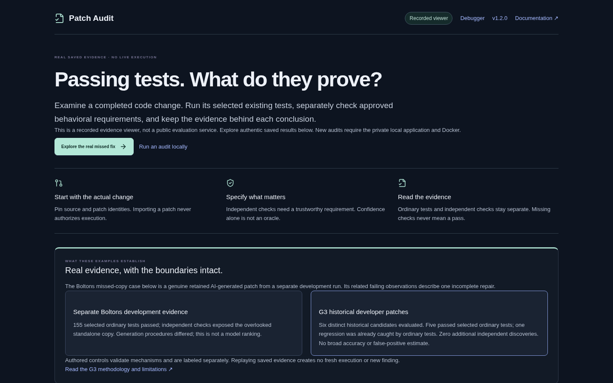
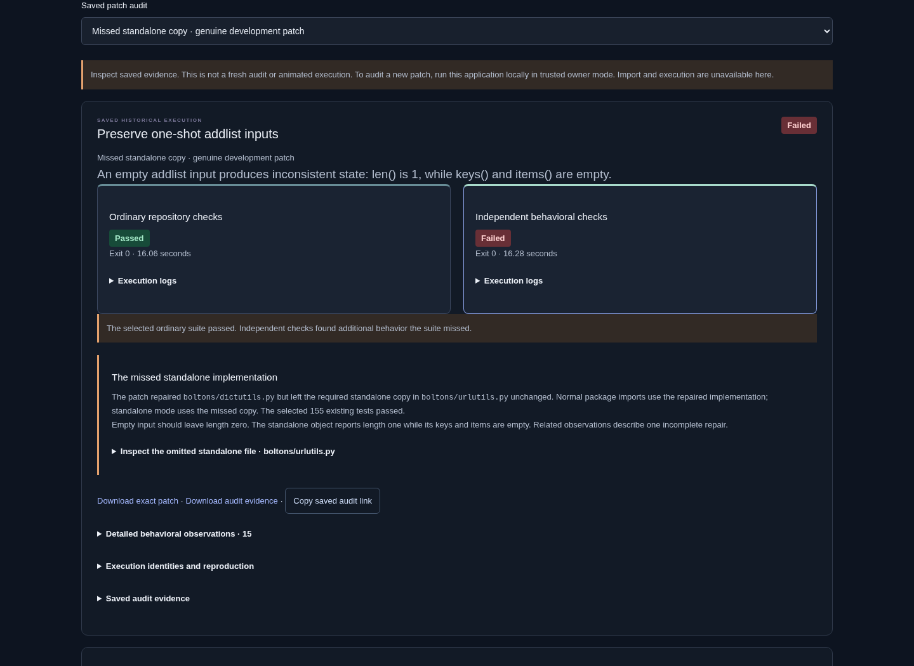
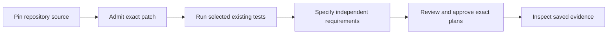

# Patch Audit

[](https://github.com/kabbersokhi-boop/ai-debugging-workbench/releases/tag/v1.2.0) · [CI](https://github.com/kabbersokhi-boop/ai-debugging-workbench/actions/workflows/ci.yml)

**Patch Audit is a workbench for inspecting completed code changes with ordinary tests and separately approved behavioral checks.** It retains evidence about the source, patch, requirements, execution and result.

> **An AI-generated fix passed 155 selected tests. It still missed a second implementation.**
> Patch Audit makes that gap inspectable—and keeps ordinary results separate from checks based on independently justified requirements.

[Explore the authentic missed-fix evidence](https://ai-debugging-workbench-recorded.vercel.app/?recordedAudit=m02-v2-development-boltons-addlist-nemotron3-r02) · [Watch the 73-second walkthrough](docs/demo/patch-audit/patch-audit-current.mp4) ([captions](docs/demo/patch-audit/patch-audit-current.vtt) · [transcript](docs/demo/patch-audit/patch-audit-current-transcript.md)) · [Run an audit locally](docs/PATCH-AUDIT-QUICKSTART.md)

<a href="docs/demo/patch-audit/patch-audit-current.mp4"></a>

The public site is a **recorded viewer**: inspect authentic saved results, patches and evidence. It cannot import or execute code. Fresh audits run in the private local application. This repository keeps its original name, `ai-debugging-workbench`; **Patch Audit** is the product.

## The real example

A retained AI-generated repair fixed `boltons/dictutils.py` but left a standalone copy broken in `boltons/urlutils.py`. The selected ordinary suite passed (**155 tests**). An independently specified empty-input check found that the standalone implementation reported length `1` instead of `0`. The empty keys and items were consistent with the same **single incomplete repair**, not separate bugs.



This is one genuine retained AI-generated example from a separate development run. It is not a G3 campaign result or a model comparison. In a distinct retrospective campaign, six genuine historical developer patches were reviewed: five passed selected ordinary tests, one regression was already caught by ordinary tests, and independent checks found **zero additional issues**. These small studies do not measure general detection accuracy. [Read the case study](docs/PATCH-AUDIT-CASE-STUDY.md).

## How an audit works



Ordinary tests show what the selected suite exercised. A separate behavioral check can reveal a gap only when its expected result comes from a source independent of the candidate: for example, upstream documentation, a public API contract or a justified owner-authored property. Patch Audit keeps that requirement, its provenance, controls, exact approval, execution and result inspectable. Without a trustworthy requirement it reports **Independent checks not configured**, never an independent pass.

## Try it

| Explore the public demo | Run an audit locally |
| --- | --- |
| [Open the saved Boltons example](https://ai-debugging-workbench-recorded.vercel.app/?recordedAudit=m02-v2-development-boltons-addlist-nemotron3-r02). Browse the actual patch, separate outcomes, expected/observed values and downloadable evidence. No installation required; no public execution. | Requires Docker Compose and a trusted local owner. The [quickstart](docs/PATCH-AUDIT-QUICKSTART.md) walks through immutable source, patch review, requirements, controls and exact approval. Keep this stack private. |

## Engineering behind the result

- **Evidence integrity:** immutable source and patch identities, exact approval bindings, saved outcomes and downloadable evidence.
- **Execution boundary:** fresh restricted local containers for ordinary and independent checks; the public recorded service has no evaluator or execution authority.
- **Independent oracle design:** provenance-backed requirements, explicit expected values, positive and negative controls, and separate recorded observations.
- **Durability:** persisted state transitions, restart recovery and idempotent reconciliation of evidence.
- **Product:** React and TypeScript flows for source review, guided requirements, diffs, evidence and saved history; Python and Node audit paths.

The checks are finite and declared. They do not discover correct specifications, prove arbitrary software correct, or provide a complete hostile-code sandbox. Containers share the host kernel; use an isolated disposable VM for adversarial source.

## Go deeper

- [First local audit, step by step](docs/PATCH-AUDIT-QUICKSTART.md)
- [Evidence-grounded case study and study accounting](docs/PATCH-AUDIT-CASE-STUDY.md)
- [Architecture and trust boundaries](docs/ARCHITECTURE.md#patch-audit-trust-boundaries)
- [Code tour](docs/CODE_TOUR.md) · [Design decisions](docs/DECISIONS.md)
- [Supported scope and execution policy](docs/GENERALIZED-PATCH-AUDIT.md)
- [G1–G4 engineering reports](docs/reports/GENERALIZED-PATCH-AUDIT-G04.md)
- [Release boundary](docs/RELEASE.md) · [v1.2.0 release notes](https://github.com/kabbersokhi-boop/ai-debugging-workbench/releases/tag/v1.2.0)

## Run locally

Requires Docker with Compose. Clone the repository:

```sh
git clone https://github.com/kabbersokhi-boop/ai-debugging-workbench.git
cd ai-debugging-workbench
```

### Browse recorded examples

```sh
docker compose -f compose.release.yaml up --build -d --wait
```

Open **http://127.0.0.1:8020/**. This mode needs no API key or database and starts no inference or
candidate execution. It includes both Patch Audit examples and the recorded debugger.

### Evaluate patches

```sh
docker compose up --build -d --wait api
```

Open **http://127.0.0.1:8010/** and choose **Audit a completed patch**. Follow the
[first Python or Node audit](docs/PATCH-AUDIT-QUICKSTART.md) through immutable source intake,
patch admission, requirements, controls and exact approval. Patch Audit needs no provider key.
The separate prepared-task selector remains available for retained historical examples.

The Docker execution stack is for trusted local use. Container restrictions and in-process Python
checks are not a complete sandbox against malicious code. Keep this stack private; the public demo
uses a separate server with no live import, model, or execution routes.
[Execution boundaries](docs/RELEASE.md) · [Patch evaluation methodology](docs/reports/PATCH-AUDIT-WORKFLOW.md).

<details>
<summary><strong>Run the AI debugger with your own NVIDIA credentials</strong></summary>

Store `NVIDIA_API_KEY` in the ignored `backend/.env` file with permissions `0600`. Only the API
receives the key; never enter credentials in the application UI.

Start the local stack with `docker compose up --build -d --wait api`, then open
**http://127.0.0.1:8010/?workspace=debugger**. Choose a supported scenario and select **Start full workflow**.
Reproduction, diagnosis, and repair have separate saved outcomes. Provider errors and rejected
proposals remain visible in the history.

```sh
docker compose logs -f api runner
docker compose down  # Keeps saved data. Adding -v deletes volumes.
```

This workflow targets a small synthetic retail application. It is not an arbitrary-repository
repair service. The original application snapshot is preserved.

</details>

<details>
<summary><strong>Inspect the producer comparison locally</strong></summary>

With the local stack running, import the saved experiment without making model calls:

```sh
uv run --project backend python -m workbench.evaluator.experiment_cli import
```

Open **http://127.0.0.1:8010/?workspace=evaluation&comparison=m02-v1** to inspect all 24 attempts,
patches, tool transcripts, provider failures, and independent observations. Handwritten controls
are displayed separately. [Reproduction instructions](evaluation/experiments/m02-v1/README.md).

</details>

## Development and verification

Requires Python 3.12, uv, Node 22.12+, and Docker. Dependencies are locked; CI requires no model credentials.

```sh
uv sync --project backend --frozen
npm ci --prefix frontend
uv run --project backend playwright install --with-deps chromium
./scripts/check  # Lint, format, types, offline tests, frontend build
```

With the local stack running, `./scripts/e2e` covers PostgreSQL, MCP, Docker, and browser journeys;
`./scripts/recovery-smoke` checks restart recovery. Recorded-server checks and isolated execution
instructions are in the [verification guide](docs/RELEASE.md#isolated-release-verification).
[Debugger evaluation protocol](evals/README.md) · [Patch Audit release](https://github.com/kabbersokhi-boop/ai-debugging-workbench/releases/tag/v1.2.0).

## Scope and licensing

Passing the named checks establishes evidence about the tested behavior, not universal correctness
or security. Prepared historical tasks retain their pinned source versions. The generalized local
workflow supports bounded public GitHub repositories in Python and Node.js, with optional separately
approved and validated behavioral checks.
The public application offers no repository intake or execution, and no automatic pull-request publication. Imported patch authorship is
user-declared. Usage is recorded where the provider returns it; monetary cost is unknown.

This repository does not currently grant a project license. Dependency and upstream attribution
remain with their respective authors.
