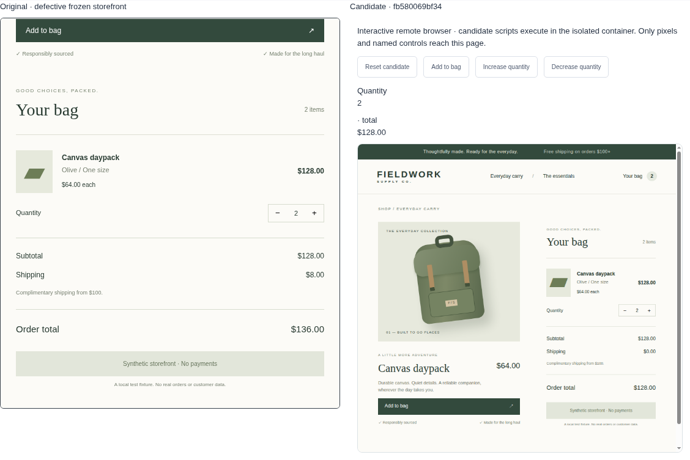
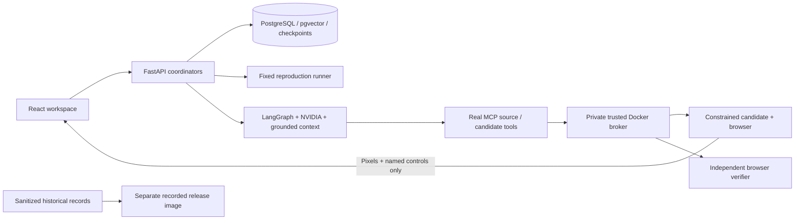

# AI debugging workbench

**Choose a real retail defect → watch NVIDIA investigate → inspect a candidate → check its behavior independently.**

The workbench reproduces browser bugs, retrieves immutable repository evidence, generates bounded code changes through a LangGraph/MCP workflow, and verifies candidates outside the model's control. Original source and every failed attempt remain inspectable.

Four development scenarios are selectable: quantity aggregation, shipping eligibility, decrement transitions, and lower input bounds. Eight additional implementation defects form the frozen held-out evaluation. This is a small synthetic retail application, not an arbitrary repository repair service.



[Captioned walkthrough of the actual saved NVIDIA run](docs/demo/walkthrough.mp4) · [Transcript and provenance](docs/demo/README.md)

## Explore without a provider key

```bash
docker compose -f compose.release.yaml up --build -d --wait
```

Open **http://127.0.0.1:8020**. The **recorded explorer** shows actual sanitized NVIDIA runs, exact diffs, source snapshots, named checks and a stopped offline security probe. It makes **no inference calls and executes no candidate JavaScript**. Historical evidence is labeled; it is never substituted for a live request.

This is tested loopback deployment preparation, **not a publicly deployed demo**. The repository remains private. Owner authorization and an approved TLS hosting destination are required for public activation. [Release boundary and activation](docs/RELEASE.md).

## Run the live product locally

Requires Docker with Compose. Put `NVIDIA_API_KEY=...` in ignored `backend/.env` with file mode `0600`; only the API receives it. Never paste credentials into the UI.

```bash
docker compose up --build -d --wait api
```

Open **http://127.0.0.1:8010**. Choose a scenario and click **Start full workflow**. Reproduction, diagnosis and repair have separate saved statuses. Inspect the prominent result, exact Monaco diff and named verification checks. The candidate's interactive view sends named controls to a remote browser and displays captured pixels; generated scripts stay inside its constrained container. The original storefront has a separate session.

Individual reproduction, investigation, cancellation, saved history, citations and evidence downloads remain available. Provider failures and rejected proposals are retained. Passing finite checks does not prove universal correctness. The original defective snapshot is never overwritten.

```bash
docker compose logs -f api runner
docker compose down                 # retains data; do not add -v
```

The broker has Docker authority and the candidate browser has its OS sandbox disabled. **Keep the live stack private.** Public deployment uses the separate recorded image, which has no broker, Docker socket, provider key or live execution API.

## Verify and reproduce measurements

Requires Python 3.12, uv, Node 22.12+ and Docker. Lockfiles are committed.

```bash
uv sync --project backend --frozen
npm ci --prefix frontend
uv run --project backend playwright install --with-deps chromium
./scripts/check
./scripts/e2e                       # offline fixtures + real PostgreSQL/MCP/Docker/browser
./scripts/recovery-smoke            # after e2e; local stack only

# Explicit real-provider opt-in; consumes the frozen experiment budget:
uv run --project backend python scripts/evaluate_repairs.py --live --split evaluation
```

The experiment checks its committed configuration, source and runtime hashes, retains failed output and charges retries before network execution. [Protocol](evals/README.md), [results and limitations](docs/RESULTS.md), [engineering report](docs/reports/MILESTONE-04.md). Existing results are reused only under the exact experiment identity; a changed experiment requires a new version.

Offline provider fixtures, actual live NVIDIA executions and recordings are labeled separately. CI requires no provider credential. Token usage is measured when the provider returns it; monetary cost is unavailable.

## How it works



[Architecture](docs/ARCHITECTURE.md) · [source tour](docs/CODE_TOUR.md) · [decisions](docs/DECISIONS.md) · [roadmap](docs/ROADMAP.md).

### Deliberate exclusions

No arbitrary repositories, uploads, generated shell commands, dependency installation, modified trusted tests, automatic publication, universal correctness claim, model leaderboard or public live sandbox. The portfolio demonstrates one bounded product with reproducible evidence. Optional extensions stay in the backlog.
