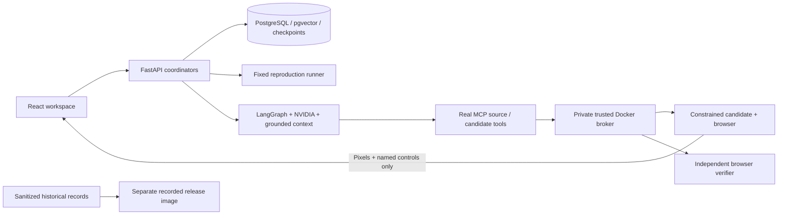

# AI debugging workbench

An AI engineering workbench that reproduces software bugs, retrieves repository evidence, generates bounded patches, and independently checks their behavior.

## Controlled producer comparison · Agent Evaluator Milestone 2

The local Agent Evaluation workspace now includes a retained comparison of **four approved tasks ×
two genuine NVIDIA model/harness configurations × three trials**. Both configurations had the same
source inspection, exact-edit and ordinary-test tools under a frozen budget.

**Actual result: 6/24 trials submitted candidates; all six passed both check sets. Independent
incremental detection was 0/6.** Eight trials produced no final submission; ten ended in provider
failure. Neither new task produced a submitted final candidate. These completion limits make the
comparison inconclusive about coding quality and do not yet support release polish or broader
product investment. M1's zero genuine additional discoveries remain historical evidence.

After the standard local setup, import the immutable retained trials without inference:

```sh
docker compose up --build -d --wait api
uv run --project backend python -m workbench.evaluator.experiment_cli import
```

Open **http://127.0.0.1:8010/?workspace=evaluation&comparison=m02-v1**. Inspect every attempt,
provider/budget failures, exact final patches, tool transcripts, fresh ordinary/independent evidence,
and separately labeled authored controls. Reopen saved PostgreSQL evaluations and download evidence.
[Experiment and reproduction](evaluation/experiments/m02-v1/README.md) ·
[Complete results and engineering report](docs/reports/AGENT-EVALUATOR-M02.md).

## Independent agent evaluation · Milestone 1

The new local **Agent Evaluation** workspace evaluates retained coding-agent patches against two
pinned upstream tasks from more-itertools and Boltons. Choose a task and candidate, run ordinary
repository checks alongside independent behavioral checks, inspect exact mismatches and diffs,
and reopen persistent evidence. Evaluation needs no provider key. The original debugger is preserved.

Run `docker compose up --build -d --wait api`, then open
**http://127.0.0.1:8010/?workspace=evaluation**.
[Task provenance and reproduction](evaluation/README.md) ·
[Engineering report and measured results](docs/reports/AGENT-EVALUATOR-M01.md)

Two fresh NVIDIA outputs are retained unedited: one passes both check sets; one fails both.
Only the explicitly authored controls demonstrate ordinary checks passing while independent checks
fail. These public historical tasks do not establish comparative agent quality or uncontaminated
benchmark performance. The evaluator is available only in the approved local execution mode.

## Existing debugging workflow

Choose a supported retail defect → observe browser reproduction → inspect NVIDIA diagnosis and source citations → review the exact patch → compare original and candidate behavior. Original source and failed attempts remain inspectable.

Four development scenarios are selectable: quantity aggregation, shipping eligibility, decrement transitions, and lower input bounds. Eight additional implementation defects form the frozen held-out evaluation. This is a small synthetic retail application, not an arbitrary repository repair service.


**[Watch the captioned walkthrough](docs/demo/walkthrough.mp4)** · [Transcript and provenance](docs/demo/README.md)

[Measured results](docs/RESULTS.md) · [Architecture](docs/ARCHITECTURE.md) · [Code tour](docs/CODE_TOUR.md)

**Two explicit modes:** the recorded explorer replays saved evidence without inference or candidate execution. The private live workbench makes real NVIDIA calls and executes bounded candidates in local containers. This source repository is **not a hosted live service**.

## Explore without a provider key

Requires Docker with Compose. Clone this repository first:

```bash
git clone https://github.com/kabbersokhi-boop/ai-debugging-workbench.git
cd ai-debugging-workbench
docker compose -f compose.release.yaml up --build -d --wait
```

Open **http://127.0.0.1:8020**. The **recorded explorer** shows actual sanitized NVIDIA runs, exact diffs, source snapshots, named checks and a stopped offline security probe. It makes **no inference calls and executes no candidate JavaScript**. Historical evidence is labeled; it is never substituted for a live request.

The recorded explorer is tested on loopback, **not deployed publicly**. Public hosting requires a separately authorized TLS destination. [Release boundary and activation](docs/RELEASE.md).

## Run the live product locally

Requires Docker with Compose. Put `NVIDIA_API_KEY=...` in ignored `backend/.env` with file mode `0600`; only the API receives it. Never paste credentials into the UI.

```bash
docker compose up --build -d --wait api
```

Open **http://127.0.0.1:8010**. Choose a scenario and click **Start full workflow**. Reproduction, diagnosis and repair have separate saved statuses. Inspect the prominent result, exact Monaco diff and named verification checks. The candidate's interactive view sends named controls to a remote browser and displays captured pixels; generated scripts stay inside its constrained container. The original storefront has a separate session.

Individual reproduction, investigation, cancellation, saved history, citations and evidence downloads remain available. Provider failures and rejected proposals are retained. Passing finite checks does not prove universal correctness. The original defective snapshot is never overwritten.

```bash
docker compose logs -f api runner
docker compose down                 # retains data; do not add -v
```

The broker has Docker authority and the candidate browser has its OS sandbox disabled. **Keep the live stack private.** Public deployment uses the separate recorded image, which has no broker, Docker socket, provider key or live execution API.

## What the engineering demonstrates

| Capability | Implementation |
| --- | --- |
| Typed Python/FastAPI, durable lifecycle and cancellation | [API](backend/src/workbench/api.py), [coordinator](backend/src/workbench/service.py), SQLAlchemy/Alembic |
| Immutable source citations, PostgreSQL full-text + pgvector hybrid retrieval, NVIDIA reranking | [Repository retrieval](backend/src/workbench/rag/retrieval.py), [source snapshots](backend/src/workbench/rag/snapshot.py) |
| NVIDIA adapters and LangChain structured grounded diagnosis | [Provider](backend/src/workbench/rag/provider.py), [diagnosis](backend/src/workbench/rag/diagnosis.py) |
| Bounded LangGraph repair with persistent checkpoints and actual MCP communication | [Repair graph](backend/src/workbench/repair/graph.py), [MCP client](backend/src/workbench/repair/mcp_client.py) |
| Candidate/source/runtime identity and independent Playwright checks | [Private broker](backend/src/workbench/repair/broker.py), [trusted verifier](backend/src/workbench/repair/verifier.py) |
| React/TypeScript investigation, source inspector and Monaco diff | [Investigation](frontend/src/Investigation.tsx), [repair workspace](frontend/src/Repair.tsx) |

### Measured outcome

| Frozen condition | Resolved held-out cases |
| --- | --- |
| One-shot, whole-target context | 8/8 |
| Repair loop, whole-target context | 8/8 |
| Repair loop, retrieval | 8/8 |

These are eight related-source synthetic defects under three conditions, not a general debugging accuracy estimate. **The experiment showed no resolution advantage from retrieval or iteration.** [Raw denominators, usage, latency and limitations](docs/RESULTS.md) are retained, including the provider retry. Dollar cost is unavailable.

## Verify and reproduce measurements

Requires Python 3.12, uv, Node 22.12+ and Docker. Lockfiles are committed.

```bash
uv sync --project backend --frozen
npm ci --prefix frontend
uv run --project backend playwright install --with-deps chromium
./scripts/check
./scripts/e2e                       # offline fixtures + real PostgreSQL/MCP/Docker/browser
./scripts/recovery-smoke            # after e2e; local stack only
uv run --project backend python scripts/check_release.py  # recorded container running
E2E_BASE_URL=http://127.0.0.1:8020 ./scripts/e2e -k recorded_explorer_first

# Recompute the committed measured-results summary; no provider call:
uv run --project backend python scripts/summarize_repairs.py
```

For a fresh real-provider replication, follow the versioned freeze/commit/run commands in the [evaluation protocol](evals/README.md#fresh-host-replication). It consumes the finite experiment budget; the original v2 runtime identity is intentionally not replaced by a new build.

The experiment checks its committed configuration, source and runtime hashes, retains failed output and charges retries before network execution. [Protocol](evals/README.md), [results and limitations](docs/RESULTS.md), [engineering report](docs/reports/MILESTONE-04.md). Existing results are reused only under the exact experiment identity; a changed experiment requires a new version.

Offline provider fixtures, actual live NVIDIA executions and recordings are labeled separately. CI requires no provider credential. Token usage is measured when the provider returns it; monetary cost is unavailable.

## How it works



[Architecture](docs/ARCHITECTURE.md) · [source tour](docs/CODE_TOUR.md) · [decisions](docs/DECISIONS.md) · [roadmap](docs/ROADMAP.md).

### Deliberate exclusions

No arbitrary repositories, uploads, generated shell commands, dependency installation, modified trusted tests, automatic publication, universal correctness claim, model leaderboard or public live sandbox. The portfolio demonstrates one bounded product with reproducible evidence. Optional extensions stay in the backlog.

## Release and licensing

The four accepted milestones are integrated into `main`; historical reports retain their original review-time status. See the [publication audit](docs/PUBLICATION_AUDIT.md) and [maintenance policy](AGENTS.md). Hosting has not been activated.

No project license has been granted in this repository. Public visibility does not supply an open-source license. Existing dependency licenses and attribution remain with their respective authors.
