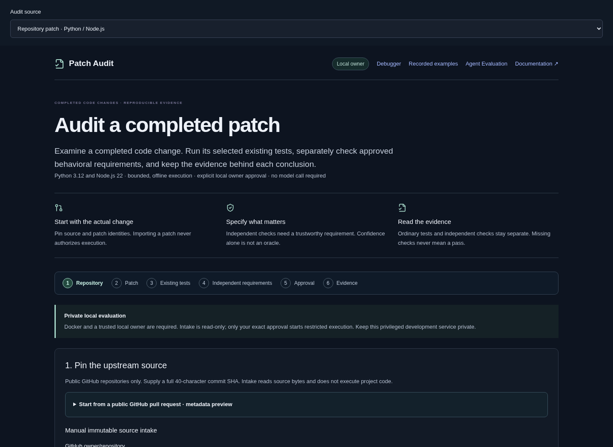
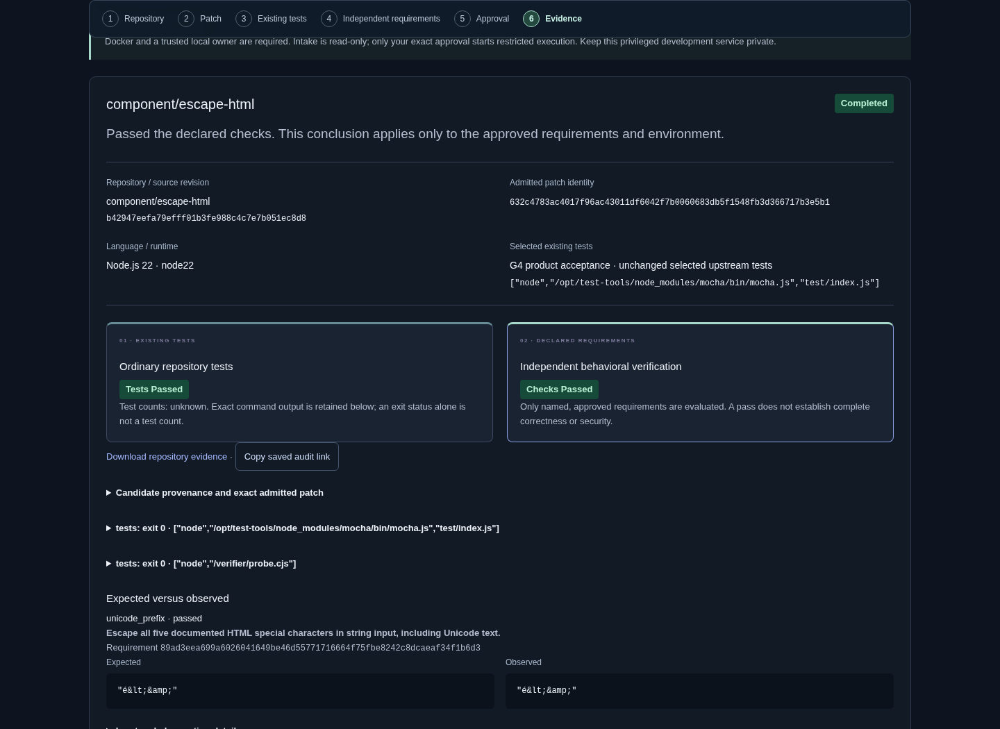
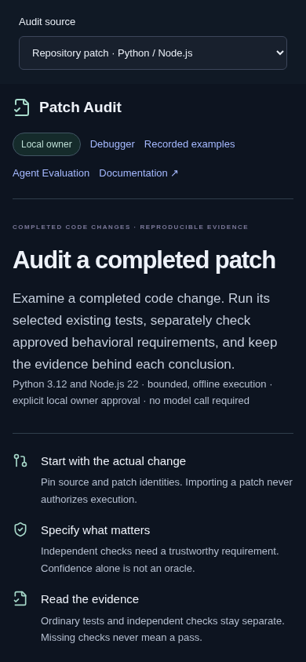
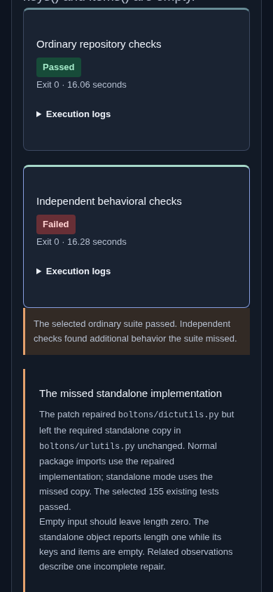

# Patch Audit

**Patch Audit is an evidence-backed workbench for checking completed code changes.**
It compares ordinary test results with separately approved behavioral checks, while retaining
reproducible evidence of what was actually executed.

[Explore the public recorded demo](https://ai-debugging-workbench-recorded.vercel.app/) ·
[First audit walkthrough](docs/PATCH-AUDIT-QUICKSTART.md) ·
[Architecture](docs/ARCHITECTURE.md#patch-audit-trust-boundaries) ·
[G4 engineering evidence](docs/reports/GENERALIZED-PATCH-AUDIT-G04.md)

The public demo shows saved evidence. **New audits run only in the private local application.**
The G4 interface shown here is a locally validated release candidate; the existing public site
has not been republished as part of G4.



## Why another check after the tests pass?

Passing selected tests establishes what those tests exercised. It cannot establish every behavior
that a change must preserve. An independent check is useful only when its expected answer has a
trustworthy specification: upstream documentation, a public API contract, an external specification
or an owner-authored property justified independently of the candidate.

Patch Audit does not ask a model or the submitted patch to decide what is correct. You specify the
behavior and finite inputs, review the provenance, validate positive and negative controls, and
approve the exact check plan. If you have no trustworthy requirement, the result says
**Independent checks not configured**. That is never an independent pass.

## One real example: the overlooked copy

A genuine retained AI-generated Boltons repair changed `dictutils.py` while leaving its standalone
copy in `urlutils.py` broken. **155 selected ordinary tests passed.** Independent checks of the
standalone implementation showed:

| Empty-input behavior | Expected | Observed |
| --- | --- | --- |
| Collection length | `0` | `1` |
| Keys | `[]` | `[]` |
| Items | `[]` | `[]` |

These related observations describe **one incomplete repair**, not three unique bugs. A separate retained patch changed both copies and passed both check sets. It predates the
missed-copy development run; the generation procedures differed; this is not a model
ranking or a G3 discovery.

[Inspect the authentic missed-copy evidence](https://ai-debugging-workbench-recorded.vercel.app/?recordedAudit=m02-v2-development-boltons-addlist-nemotron3-r02) ·
[Exact patch](evaluation/experiments/m02-v2/development/independent/m02-v2-development-boltons-addlist-nemotron3-r02.patch) ·
[Generation provenance](evaluation/experiments/m02-v2/README.md)


## From repository to inspectable evidence

**Repository → Patch → Existing tests → Independent requirements → Approval → Evidence**

1. Pin a public GitHub repository to a full immutable commit. Source intake checks the archive,
   tree and blob identities without executing project code.
2. Admit an exact production-only patch against that snapshot. Review the change and scope.
3. Choose the Python or Node runtime and explicit existing-test argument vector. Review any offline
   setup; neither a README nor a PR link authorizes commands.
4. Optionally specify independent requirements and named JSON behavior examples. Inspect provenance,
   assumptions and exact expected values. Positive and negative controls must validate first.
5. Approve the exact source, patch, ordinary plan and, when configured, validated independent plan.
   Changes invalidate approval. Execution uses fresh, separate, restricted local containers.
6. Read distinct ordinary/independent outcomes, expected versus observed values and execution logs.
   Download the exact patch/evidence, copy the saved link, and reopen history without re-executing.

The local GitHub PR convenience is **metadata preview only**. It shows observed base/head commits
and change counts using unauthenticated, fixed-host HTTPS. It does not import a PR, infer a test
command, approve execution or guarantee compatibility. The PR base tip need not be its diff's
merge-base. Continue through explicit immutable source and production-only patch admission.



<p>
  
  
</p>

## Supported scope

| Area | Current boundary |
| --- | --- |
| Source | Public GitHub, full 40-character commit; bounded regular-file snapshots, no submodules, LFS or symlinks |
| Patch | UTF-8/LF exact diff, ≤64 KiB, ≤4 existing approved production files; no tests/configuration, file-mode changes, additions or deletions |
| Python | Python 3.12, pinned pytest; offline dependencies only, source stays read-only |
| Node.js | Node 22, built-in tests or pinned Mocha; optional pinned `array-flatten` compatibility preset |
| Independent checks | Declarative finite JSON arguments/results from a public Python/Node function; expected values are withheld from the scored candidate’s observation container and compared by the broker |
| Conclusions | Declared scope only; unsupported, ambiguous, incomplete, interrupted, invalid and infrastructure outcomes remain visible |
| Prepared examples | Four historical Python tasks, plus optional existing debugger workflows; separate from generalized repository intake |

Containers run non-root, without network, credentials, Docker sockets or unrelated host mounts,
with read-only inputs and resource/time/output bounds. They share the host kernel. **This is not a
complete hostile-code sandbox.** Use an isolated disposable VM for adversarial repositories and
keep the privileged local service private.

Synthetic positive/negative controls necessarily encode their authored outputs. This isolation
claim concerns the scored candidate; controls do not establish the truth of the specification.

[Detailed admission and execution policy](docs/GENERALIZED-PATCH-AUDIT.md) ·
[Independent verification design](docs/reports/GENERALIZED-PATCH-AUDIT-G02.md)

## Engineering worth inspecting

- **Backend:** typed async FastAPI, Pydantic contracts, PostgreSQL/Alembic, durable state transitions,
  idempotent evidence reconciliation and bounded cancellation-aware restart recovery.
- **Integrity:** recomputed source/patch identities; exact candidate/plan/runtime/approval bindings;
  immutable terminal outcomes and downloadable evidence, including unsuccessful executions.
- **Test-oracle design:** versioned verifiers, independently justified expectations, isolated
  observations, positive/negative controls and validation before candidate scoring.
- **Product:** React/TypeScript, code diffs, guided requirements, progressive evidence disclosure,
  keyboard focus and responsive layouts. Browser tests exercise real local evaluation.
- **Public boundary:** a physically separate recorded server/image has no workbench evaluator,
  database credentials, Docker module/socket, host mounts or mutation endpoints.

[Code tour](docs/CODE_TOUR.md) · [Design decisions](docs/DECISIONS.md) ·
[Release boundary](docs/RELEASE.md)

## What the evaluations actually found

| Evidence set | Observed result |
| --- | --- |
| G3 historical developer patches, including separate Node addendum | Six distinct genuine candidates evaluated. Five passed selected ordinary tests; one regression was already caught by ordinary tests. **Zero additional independent findings**, no repeat disagreements. No broad detection-accuracy or false-positive-rate estimate. |
| Earlier four-task producer comparison | 24 attempts, six submissions; all six passed both check sets. Eight attempts had no submission; ten had provider failures. **0/6 additional independent failures.** |
| Separate Boltons development runs | Four attempts, one submission: the featured ordinary-passing missed-copy repair. Three other attempts produced no submission. Different procedure; not pooled with G3 or the comparison. |
| Authored controls | Deliberately constructed checks of evaluator behavior, labeled separately; not genuine AI or historical developer discoveries. |

[G3 original report](docs/reports/GENERALIZED-PATCH-AUDIT-G03.md) ·
[Node addendum and accepted recovery correction](docs/reports/GENERALIZED-PATCH-AUDIT-G03-COMPATIBILITY.md) ·
[Earlier producer comparison](docs/reports/AGENT-EVALUATOR-M02.md) ·
[Synthetic debugger study](docs/RESULTS.md)

The task sets are small and use public historical source. Results do not establish universal
correctness, security, production-scale reliability, measured superiority or model rankings.
G4 improves product access and release readiness; it runs **no new benchmark campaign**.

## Run locally

Requires Docker with Compose. Clone the repository:

```sh
git clone https://github.com/kabbersokhi-boop/ai-debugging-workbench.git
cd ai-debugging-workbench
```

### Browse recorded examples

```sh
docker compose -f compose.release.yaml up --build -d --wait
```

Open **http://127.0.0.1:8020/**. This mode needs no API key or database and starts no inference or
candidate execution. It includes both Patch Audit examples and the recorded debugger.

### Evaluate patches

```sh
docker compose up --build -d --wait api
```

Open **http://127.0.0.1:8010/**. Select a supported task, review a patch, and explicitly confirm its
audit. Patch Audit needs no provider key. Imports must match the supported source versions and files.

The Docker execution stack is for trusted local use. Container restrictions and in-process Python
checks are not a complete sandbox against malicious code. Keep this stack private; the public demo
uses a separate server with no live import, model, or execution routes.
[Execution boundaries](docs/RELEASE.md) · [Patch evaluation methodology](docs/reports/PATCH-AUDIT-WORKFLOW.md).

<details>
<summary><strong>Run the AI debugger with your own NVIDIA credentials</strong></summary>

Store `NVIDIA_API_KEY` in the ignored `backend/.env` file with permissions `0600`. Only the API
receives the key; never enter credentials in the application UI.

Start the local stack with `docker compose up --build -d --wait api`, then open
**http://127.0.0.1:8010/?workspace=debugger**. Choose a supported scenario and select **Start full workflow**.
Reproduction, diagnosis, and repair have separate saved outcomes. Provider errors and rejected
proposals remain visible in the history.

```sh
docker compose logs -f api runner
docker compose down  # Keeps saved data. Adding -v deletes volumes.
```

This workflow targets a small synthetic retail application. It is not an arbitrary-repository
repair service. The original application snapshot is preserved.

</details>

<details>
<summary><strong>Inspect the producer comparison locally</strong></summary>

With the local stack running, import the saved experiment without making model calls:

```sh
uv run --project backend python -m workbench.evaluator.experiment_cli import
```

Open **http://127.0.0.1:8010/?workspace=evaluation&comparison=m02-v1** to inspect all 24 attempts,
patches, tool transcripts, provider failures, and independent observations. Handwritten controls
are displayed separately. [Reproduction instructions](evaluation/experiments/m02-v1/README.md).

</details>

## Development and verification

Requires Python 3.12, uv, Node 22.12+, and Docker. Dependencies are locked; CI requires no model credentials.

```sh
uv sync --project backend --frozen
npm ci --prefix frontend
uv run --project backend playwright install --with-deps chromium
./scripts/check  # Lint, format, types, offline tests, frontend build
```

With the local stack running, `./scripts/e2e` covers PostgreSQL, MCP, Docker, and browser journeys;
`./scripts/recovery-smoke` checks restart recovery. Recorded-server checks and isolated execution
instructions are in the [verification guide](docs/RELEASE.md#isolated-release-verification).
[Debugger evaluation protocol](evals/README.md) · [Patch Audit release](https://github.com/kabbersokhi-boop/ai-debugging-workbench/releases/tag/v1.1.0).

## Scope and licensing

Passing the named checks establishes evidence about the tested behavior, not universal correctness
or security. Prepared historical tasks retain their pinned source versions. The generalized local
workflow supports bounded public GitHub repositories in Python and Node.js, with optional separately
approved and validated behavioral checks.
The public application offers no repository intake or execution, and no automatic pull-request publication. Imported patch authorship is
user-declared. Usage is recorded where the provider returns it; monetary cost is unknown.

This repository does not currently grant a project license. Dependency and upstream attribution
remain with their respective authors.
