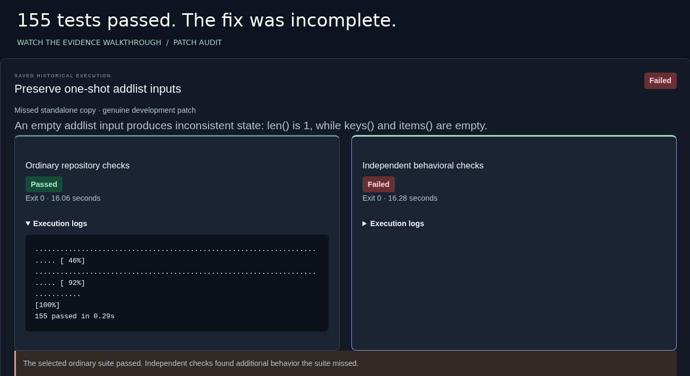
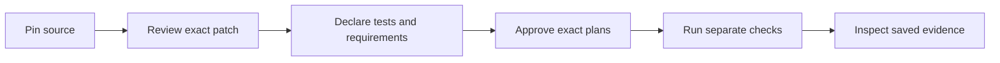

# Patch Audit

**Inspect a completed code change with existing tests and independently specified behavioral checks. Keep the evidence behind the result.**

> An AI-generated fix passed **155 selected tests**. It still missed a second implementation.

[Explore the real missed fix](https://ai-debugging-workbench-recorded.vercel.app/?recordedAudit=m02-v2-development-boltons-addlist-nemotron3-r02#saved-patch-evidence) · [Run an audit locally](docs/PATCH-AUDIT-QUICKSTART.md) · [v1.2.0](https://github.com/kabbersokhi-boop/ai-debugging-workbench/releases/tag/v1.2.0) · [CI](https://github.com/kabbersokhi-boop/ai-debugging-workbench/actions/workflows/ci.yml)

The public demo replays authentic saved evidence. **New audits run locally with Docker; the public site cannot execute code.**

[](frontend/public/demo/patch-audit/walkthrough.mp4?raw=true)

**[Download the 109-second narrated walkthrough (MP4, 3.98 MB)](frontend/public/demo/patch-audit/walkthrough.mp4?raw=true)** · [Captions](frontend/public/demo/patch-audit/captions.vtt) · [Transcript](frontend/public/demo/patch-audit/transcript.txt)

`ai-debugging-workbench` is the repository's original name; **Patch Audit** is its primary workflow.

## The repair that tests missed

Boltons, a Python utility library, keeps two copies of its ordered multi-dictionary: a main implementation and a fallback for using its URL module on its own. The retained AI patch repaired `OrderedMultiDict.addlist` in `dictutils.py` and left the `urlutils.py` copy unchanged.

| Check | Saved result |
| --- | --- |
| Selected existing tests (`test_dictutils.py`, `test_urlutils.py`) | **155 passed** |
| Independent check of empty input in the standalone copy | Expected length **0**; observed **1**, with empty keys and items |
| What this establishes | **One incomplete repair**: the second implementation was missed |

Normal package imports can reuse the repaired class, masking the standalone fallback. The extra check exercised that fallback against an independently specified requirement. [Follow the case, source and original evidence](docs/PATCH-AUDIT-CASE-STUDY.md).

## Try it

**Explore saved evidence — no installation.** [Open the Boltons record](https://ai-debugging-workbench-recorded.vercel.app/?recordedAudit=m02-v2-development-boltons-addlist-nemotron3-r02#saved-patch-evidence). Expand the ordinary log, inspect `standalone_urlutils:empty`, review the exact patch, and download the evidence. Viewing a record does not rerun it.

**Audit a new patch — local Docker application.** No model key is needed. Requires Git and Docker Compose; Linux is the tested environment.

```sh
git clone https://github.com/kabbersokhi-boop/ai-debugging-workbench.git
cd ai-debugging-workbench
git checkout v1.2.0
docker compose up --build -d --wait api
```

Open **http://127.0.0.1:8010/** and choose **Audit a completed patch**. The [Python/Node quickstart](docs/PATCH-AUDIT-QUICKSTART.md) supplies an accepted example and walks through source admission, patch review, requirements, controls and exact approval. Keep the privileged local stack private. For offline viewing after the image is built, use the [separate recorded-only image](docs/RELEASE.md).

## How it works



Existing tests establish what they exercised. A separate check is useful only when its expected behavior has an independent justification: upstream documentation, an API contract or a reviewed owner-authored property. Patch Audit retains that provenance. Positive and negative controls must validate before final independent-plan approval; they check the checker, not the truth of the specification.

Without a trustworthy requirement, the result says **Independent checks not configured**. Passing selected tests never becomes an independent pass by default.

## Engineering decisions worth inspecting

| Problem | Implementation and tradeoff |
| --- | --- |
| The reviewed patch must be the one executed | Recomputed Git tree/blob and patch identities, typed plans, and approval bound to exact inputs. [Source admission](backend/src/workbench/repository_audit/intake.py), [patch admission](backend/src/workbench/repository_audit/admission.py). |
| Candidate code must not define its own expected answer | Separate ordinary/independent containers; expected values stay with the trusted broker; provenance and controls remain inspectable. The specification still needs human judgment. [Independent verification](backend/src/workbench/repository_audit/independent.py). |
| A restart must not invent a pass or silently resubmit work | PostgreSQL state transitions, bound terminal evidence and idempotent recovery. Missing evidence has a bounded recovery budget and remains an explicit interrupted/error outcome. [Recovery](backend/src/workbench/repository_audit/recovery.py). |
| A public demo must not inherit local execution authority | A separate recorded server/image serves curated evidence and the React/TypeScript interface, with no evaluator, database credentials or Docker socket. [Public server](backend/src/workbench/release.py), [image](docker/release.Dockerfile). |

The local workflow supports bounded public GitHub snapshots in **Python 3.12 and Node 22**. Containers are restricted and network-disabled but share the host kernel; use an isolated disposable VM for adversarial source. Finite checks do not establish universal correctness or security. [Supported scope and policy](docs/GENERALIZED-PATCH-AUDIT.md) · [Architecture](docs/ARCHITECTURE.md#patch-audit-trust-boundaries) · [Code tour](docs/CODE_TOUR.md).

## What the evaluations established

These are distinct studies with different provenance; their outcomes are not pooled.

| Evidence set | Actual outcome |
| --- | --- |
| Featured Boltons development run | One genuine AI-generated submission passed 155 selected tests and failed independent checks: **one incomplete repair**. Three other development attempts made no submission. |
| G3 retrospective, including its Node addendum | Six genuine historical **developer** patches evaluated. Five ordinary passes; one regression already caught ordinarily. **Zero additional independent findings.** |
| Earlier four-task producer comparison | 24 attempts: six submissions, all six passed both check sets; eight made no submission; ten had provider failures. **0/6 additional independent failures.** |
| Authored controls | Deliberately constructed examples validate evaluator behavior. They are not genuine AI or historical developer discoveries. |

The samples are small and historical. They do not establish general detection accuracy, false-positive rates, model rankings or measured superiority. The earlier Boltons record predates the generalized approval forms and retains its original verifier evidence. [Case study and methodology](docs/PATCH-AUDIT-CASE-STUDY.md) · [G3 report](docs/reports/GENERALIZED-PATCH-AUDIT-G03.md) · [Node addendum](docs/reports/GENERALIZED-PATCH-AUDIT-G03-COMPATIBILITY.md) · [Producer comparison](docs/reports/AGENT-EVALUATOR-M02.md).

## Review the implementation

- [Architecture and trust boundaries](docs/ARCHITECTURE.md#patch-audit-trust-boundaries) · [Code tour](docs/CODE_TOUR.md) · [Design decisions](docs/DECISIONS.md)
- [G4 product acceptance and earlier G1–G3 reports](docs/reports/GENERALIZED-PATCH-AUDIT-G04.md) · [Final release review](docs/reports/PATCH-AUDIT-FINAL-REVIEW.md)
- [Release boundary and verification](docs/RELEASE.md) · [Current and historical demonstrations](docs/demo/README.md)

Development requires Python 3.12, uv, Node 22.12+ and Docker. Locked dependencies and CI need no model credentials:

```sh
uv sync --project backend --frozen
npm ci --prefix frontend
./scripts/check
# With the local stack running:
./scripts/e2e
```

The [case study](docs/PATCH-AUDIT-CASE-STUDY.md#provenance-and-ownership) distinguishes artifact-backed claims from personal ownership claims and identifies Codex assistance in this presentation work. This repository does not currently grant a project license; upstream source and dependencies retain their respective attribution and licenses.
