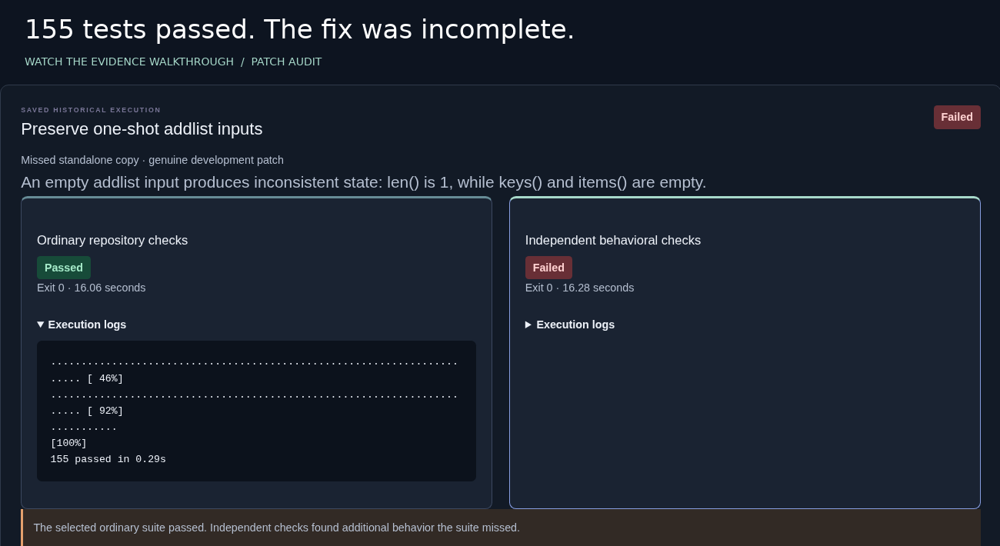

# Patch Audit

**Give it a patch, choose what must keep working, and inspect a result you can reproduce.**

An AI-generated fix passed **155 selected tests**. It still missed a second implementation.
[Explore the saved example](https://ai-debugging-workbench-recorded.vercel.app/?recordedAudit=m02-v2-development-boltons-addlist-nemotron3-r02#saved-patch-evidence) to see what passed, what failed and why.

The public demo shows saved results. **New audits run on your computer with Docker. The public site cannot execute code.**

[Get started](docs/PATCH-AUDIT-QUICKSTART.md) · [Documentation](docs/README.md) · [Test results](docs/VALIDATION.md) · [CI](https://github.com/kabbersokhi-boop/ai-debugging-workbench/actions/workflows/ci.yml)

[](https://raw.githubusercontent.com/kabbersokhi-boop/ai-debugging-workbench/fffe669713526014b5ae4d6f3ae08fe38bb8981f/frontend/public/demo/patch-audit/walkthrough.mp4)

[Recorded walkthrough: MP4, 109 seconds](https://raw.githubusercontent.com/kabbersokhi-boop/ai-debugging-workbench/fffe669713526014b5ae4d6f3ae08fe38bb8981f/frontend/public/demo/patch-audit/walkthrough.mp4) · [Captions](frontend/public/demo/patch-audit/captions.vtt) · [Transcript](frontend/public/demo/patch-audit/transcript.txt)

## What you can do

- Follow the Boltons example through passing tests, an overlooked implementation and a failing input.
- Run a prepared Python or Node example locally, with the inputs filled in for review.
- Save a project checklist and reuse it for another patch, in the browser or terminal.
- Generate small inputs for supported Python functions and simplify a failing example.
- Download the patch, a readable report and the complete execution evidence.

Each new run requires your approval. A saved checklist or previous result does not authorize another execution.

## Run it locally

You need Git and Docker with Compose. Linux is the tested environment. No model key is needed.

```sh
git clone https://github.com/kabbersokhi-boop/ai-debugging-workbench.git
cd ai-debugging-workbench
git switch main
docker compose up --build -d --wait api
```

Open **http://127.0.0.1:8010/** and choose **Run a prepared example locally**. Review the source, patch, commands and expected behavior, then approve the checks. The [quickstart](docs/PATCH-AUDIT-QUICKSTART.md) explains each step.

These instructions use the latest source on `main`. The [published v1.2.1 release](https://github.com/kabbersokhi-boop/ai-debugging-workbench/releases/tag/v1.2.1) and recorded film predate the newer checklist and generated-input workflows. Merging source changes does not update the hosted demo.

Keep the Docker application private. It can execute repository code after approval. For code you do not trust, use an isolated disposable virtual machine. [Execution limits](docs/GENERALIZED-PATCH-AUDIT.md) · [Recorded viewer](docs/RELEASE.md).

## The repair that tests missed

Boltons, a Python utility library, keeps two copies of its ordered multi-dictionary: the usual implementation and a fallback for using its URL module on its own. The saved AI patch fixed `dictutils.py` and left the copy in `urlutils.py` unchanged.

| Check | Saved result |
| --- | --- |
| Selected existing tests | **155 passed** |
| Empty input in the standalone copy | Expected length **0**; observed **1**, while keys and items were empty |
| What this shows | **One incomplete repair:** the second implementation was missed |

Normal imports can use the repaired class and hide the remaining defect. The extra check tested the standalone copy against a separately justified requirement. [Read the case study and inspect the original evidence](docs/PATCH-AUDIT-CASE-STUDY.md).

## How checks work

Choose the tests to run and describe the behavior that matters. Expected behavior must have a supporting source, such as documentation, an API contract or a specification you wrote independently of the patch.

Before running those checks, Patch Audit tests the checking setup with examples designed to pass and fail. You then approve the exact source, patch and commands. Existing tests and additional behavior checks run separately, and their results stay separate in the report.

A pass applies only to the selected checks and environment. Missing checks, failed setup and interrupted runs are never presented as proof that a patch is correct. Generated inputs are limited to supported Python functions; a simpler failing input is not a guarantee of the smallest possible example.

## What the evidence shows

These are separate evidence sets, not a combined accuracy score.

| Evidence | Result |
| --- | --- |
| Saved Boltons AI-generated repair | One incomplete repair passed 155 selected tests and failed additional behavior checks. |
| Historical developer-patch study | Six patches tested: five passed existing tests; one regression was already caught by those tests. Additional checks found no further defects. |
| Earlier model comparison | 24 attempts: six submitted patches passed both check sets, eight made no submission and ten had provider failures. No additional failures were found among the six submissions. |
| Deliberately faulty examples | Used to test failure detection, simplification and reproduction. These are test examples, not newly discovered defects. |

These small, historical studies do not establish general detection accuracy, model rankings or improved usability. [Evidence and limitations](docs/VALIDATION.md) · [Case study](docs/PATCH-AUDIT-CASE-STUDY.md).

## Contributing

Development uses Python 3.12, uv, Node 22.12+ and Docker. Standard checks need no model credentials:

```sh
uv sync --project backend --frozen
npm ci --prefix frontend
uv run --project backend playwright install --with-deps chromium
./scripts/check
# With the local application running:
./scripts/e2e
```

[Code tour](docs/CODE_TOUR.md) · [Architecture](docs/ARCHITECTURE.md#patch-audit-trust-boundaries) · [Contributor guidance](AGENTS.md) · [Roadmap](docs/ROADMAP.md)

The repository's original name is `ai-debugging-workbench`. Its earlier debugger experiments remain available as technical references. Development has used Codex assistance; no unaided-authorship claim is made. This repository does not currently grant a project license. Upstream source and dependencies retain their respective attribution and licenses.
