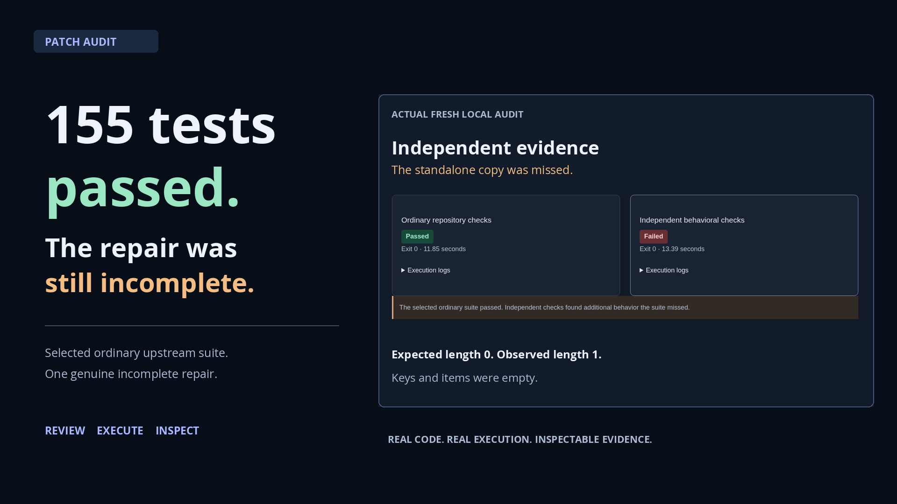

<h1 align="center">Patch Audit</h1>

<p align="center"><strong>Independent checks for AI-generated code repairs.</strong></p>

<p align="center">Reproduce bugs, review proposed fixes, and inspect the evidence behind each result.</p>

<p align="center">
  <a href="https://github.com/kabbersokhi-boop/ai-debugging-workbench/releases/download/v1.1.0/patch-audit-60s-captioned.mp4"><strong>Watch the 60-second demo</strong></a> &nbsp;·&nbsp;
  <a href="https://github.com/kabbersokhi-boop/ai-debugging-workbench/releases/download/v1.1.0/patch-audit-full-captioned.mp4"><strong>Watch the full demo</strong></a> &nbsp;·&nbsp;
  <a href="https://ai-debugging-workbench-recorded.vercel.app/"><strong>Explore Patch Audit</strong></a>
</p>

<p align="center">
  <a href="https://github.com/kabbersokhi-boop/ai-debugging-workbench/releases/download/v1.1.0/patch-audit-60s-captioned.mp4">
    
  </a>
</p>

<p align="center"><sub>The public demo displays recorded results. No API key or installation required.</sub></p>

An AI-generated patch passed **155 selected upstream tests** while leaving a required implementation
broken. Patch Audit made the missing behavior visible, with the exact diff, test output, and
expected-versus-observed evidence available for inspection.

Built with **Python, FastAPI, React, TypeScript, PostgreSQL, Docker, and Playwright**, the workbench
also includes AI diagnosis with source citations and bounded repair workflows using **NVIDIA,
LangGraph, and MCP**. Fresh patch evaluation runs locally.

[Captions, transcripts, and clean video versions](docs/demo/patch-audit/README.md) ·
[Architecture](docs/ARCHITECTURE.md) · [Code tour](docs/CODE_TOUR.md)

## The case: passing tests, incomplete repair

A model fixed Boltons' main `OrderedMultiDict` implementation but missed its standalone copy in
`urlutils.py`. The selected ordinary test suite passed. Independent behavioral checks exercised
that second implementation and found an inconsistent state:

| Empty-input behavior | Expected | Observed |
| --- | --- | --- |
| Collection length | `0` | `1` |
| Keys | `[]` | `[]` |
| Items | `[]` | `[]` |

The collection reported one entry while exposing no keys or items. The related failures describe
**one incomplete repair**. A different model-generated patch fixes both implementations and passes
both check sets. These examples came from different generation procedures and are not a vendor comparison.

**[Inspect the incomplete repair](https://ai-debugging-workbench-recorded.vercel.app/?recordedAudit=m02-v2-development-boltons-addlist-nemotron3-r02)** ·
**[Inspect the complete correction](https://ai-debugging-workbench-recorded.vercel.app/?recordedAudit=m02-v1-boltons-addlist-nemotron35-r02)** ·
[Exact incomplete patch](evaluation/experiments/m02-v2/development/independent/m02-v2-development-boltons-addlist-nemotron3-r02.patch)

## What you can do

### Audit a completed patch

1. Choose a supported task and load an existing candidate or import a `.patch` / `.diff`.
2. Review the exact change, source version, and patch origin. Importing does not execute code.
3. Confirm local execution to run ordinary tests and independent behavioral checks in fresh containers.
4. Inspect separate outcomes, logs, mismatches, and reproduction details; download or reopen the saved audit.

Patch Audit supports **four Python tasks from Boltons and more-itertools**, with pinned source
versions and permitted production files. Evaluating a completed patch requires no model call or
provider key. [Supported tasks and upstream attribution](evaluation/experiments/m02-v1/README.md).

### Bring an external repository (experimental, local only)

Select **External repository** in the local Patch Audit workspace. Pin a public GitHub
repository to a full commit SHA, import a production-only patch, review and explicitly approve
a Python 3.12 or Node 22 test plan, then inspect, download and reopen the result. Repository
intake does not execute code. Setup and tests run without network in restricted containers;
unsupported dependencies fail clearly. Independent verification is **not configured** for G1.
[Requirements, commands and security boundary](docs/GENERALIZED-PATCH-AUDIT.md) ·
[Executed examples and engineering review](docs/reports/GENERALIZED-PATCH-AUDIT-G01.md).

### Investigate and repair a reproduced defect

The debugging workspace reproduces supported defects in a retail web application, retrieves
relevant source, and uses NVIDIA models to propose a diagnosis with source citations. A bounded
LangGraph workflow uses MCP tools to inspect source and construct candidates; separate Playwright
checks evaluate their browser behavior. You can compare the original and proposed repair, inspect
the diff, and follow the execution history.

**[Explore the recorded debugger](https://ai-debugging-workbench-recorded.vercel.app/?workspace=debugger)** ·
[Debugger walkthrough](docs/demo/README.md#original-debugger-demonstration)

## Engineering highlights

| Capability | Implementation |
| --- | --- |
| **Independent verification** | Ordinary tests and separate behavioral checks, linked to exact source, patch, verifier, and runtime identities. [Evaluation code](backend/src/workbench/patch_audit/execution.py) |
| **Diagnosis with source citations** | PostgreSQL full-text and pgvector retrieval, NVIDIA reranking, and citations tied to the supplied source snapshot. [Retrieval](backend/src/workbench/rag/retrieval.py) · [Diagnosis](backend/src/workbench/rag/diagnosis.py) |
| **Bounded agent workflows** | LangGraph checkpoints, MCP tools, cancellation, and limits on requests, tokens, time, and revisions. [Repair graph](backend/src/workbench/repair/graph.py) |
| **Durable execution history** | Typed FastAPI services and PostgreSQL persist outcomes, partial progress, and evidence across refreshes and restarts. [Coordinator](backend/src/workbench/service.py) |
| **Separate execution environments** | Docker isolates candidates from trusted checks; credentials stay in the coordinator. The public server has no execution authority. [Broker](backend/src/workbench/repair/broker.py) · [Public server](backend/src/workbench/release.py) |
| **Code and evidence review** | React, TypeScript, and Monaco connect diffs, source citations, check outcomes, and downloadable evidence. [Investigation UI](frontend/src/Investigation.tsx) · [Repair UI](frontend/src/Repair.tsx) |

[Design decisions](docs/DECISIONS.md) · [Patch evaluation methodology](docs/reports/PATCH-AUDIT-WORKFLOW.md)

## What the experiments found

The project reports incomplete attempts and negative results alongside successful repairs.

| Experiment | Result |
| --- | --- |
| **Four-task producer comparison** | Two NVIDIA model/harness configurations, **24 attempts, 6 submissions**. All six passed both check sets: **0/6 additional independent failures**. Eight attempts had no submission; ten ended in provider failure. [Study results](docs/reports/AGENT-EVALUATOR-M02.md) |
| **Separate development runs** | **4 attempts, 1 submission**. That patch passed 155 ordinary tests and failed independent checks: **1/1 additional failure**. Three attempts produced no submission. This is the featured repair above. [Evidence](evaluation/experiments/m02-v2/README.md) |
| **Synthetic debugging study** | A single proposal with full source, a repair loop with full source, and a repair loop with retrieval each resolved **8/8 related synthetic retail defects**. Retrieval and iteration did not improve the resolution count. [Measurements](docs/RESULTS.md) |

Completion reliability limited the four-task comparison; neither new task produced a submission.
It does not establish a ranking of coding ability. The development runs used a different procedure
and are reported separately.

An earlier two-task pilot found **no additional failure in model-generated patches**: one passed both
check sets and one failed both. Handwritten controls were evaluated separately and are not model
results. [Pilot methodology](docs/reports/AGENT-EVALUATOR-M01.md).

These studies use small task sets and public historical source. Their results do not establish
uncontaminated benchmark performance, a production success rate, or universal model rankings.

## Run locally

Requires Docker with Compose. Clone the repository:

```sh
git clone https://github.com/kabbersokhi-boop/ai-debugging-workbench.git
cd ai-debugging-workbench
```

### Browse recorded examples

```sh
docker compose -f compose.release.yaml up --build -d --wait
```

Open **http://127.0.0.1:8020/**. This mode needs no API key or database and starts no inference or
candidate execution. It includes both Patch Audit examples and the recorded debugger.

### Evaluate patches

```sh
docker compose up --build -d --wait api
```

Open **http://127.0.0.1:8010/**. Select a supported task, review a patch, and explicitly confirm its
audit. Patch Audit needs no provider key. Imports must match the supported source versions and files.

The Docker execution stack is for trusted local use. Container restrictions and in-process Python
checks are not a complete sandbox against malicious code. Keep this stack private; the public demo
uses a separate server with no live import, model, or execution routes.
[Execution boundaries](docs/RELEASE.md) · [Patch evaluation methodology](docs/reports/PATCH-AUDIT-WORKFLOW.md).

<details>
<summary><strong>Run the AI debugger with your own NVIDIA credentials</strong></summary>

Store `NVIDIA_API_KEY` in the ignored `backend/.env` file with permissions `0600`. Only the API
receives the key; never enter credentials in the application UI.

Start the local stack with `docker compose up --build -d --wait api`, then open
**http://127.0.0.1:8010/?workspace=debugger**. Choose a supported scenario and select **Start full workflow**.
Reproduction, diagnosis, and repair have separate saved outcomes. Provider errors and rejected
proposals remain visible in the history.

```sh
docker compose logs -f api runner
docker compose down  # Keeps saved data. Adding -v deletes volumes.
```

This workflow targets a small synthetic retail application. It is not an arbitrary-repository
repair service. The original application snapshot is preserved.

</details>

<details>
<summary><strong>Inspect the producer comparison locally</strong></summary>

With the local stack running, import the saved experiment without making model calls:

```sh
uv run --project backend python -m workbench.evaluator.experiment_cli import
```

Open **http://127.0.0.1:8010/?workspace=evaluation&comparison=m02-v1** to inspect all 24 attempts,
patches, tool transcripts, provider failures, and independent observations. Handwritten controls
are displayed separately. [Reproduction instructions](evaluation/experiments/m02-v1/README.md).

</details>

## Development and verification

Requires Python 3.12, uv, Node 22.12+, and Docker. Dependencies are locked; CI requires no model credentials.

```sh
uv sync --project backend --frozen
npm ci --prefix frontend
uv run --project backend playwright install --with-deps chromium
./scripts/check  # Lint, format, types, offline tests, frontend build
```

With the local stack running, `./scripts/e2e` covers PostgreSQL, MCP, Docker, and browser journeys;
`./scripts/recovery-smoke` checks restart recovery. Recorded-server checks and isolated execution
instructions are in the [verification guide](docs/RELEASE.md#isolated-release-verification).
[Debugger evaluation protocol](evals/README.md) · [Patch Audit release](https://github.com/kabbersokhi-boop/ai-debugging-workbench/releases/tag/v1.1.0).

## Scope and licensing

Passing the named checks establishes evidence about the tested behavior, not universal correctness
or security. The historical independent evaluator supports specific tasks and source versions. Experimental
G1 ordinary-test execution supports bounded public GitHub repositories in trusted local mode.
The public application offers no repository intake or execution, and no automatic pull-request publication. Imported patch authorship is
user-declared. Usage is recorded where the provider returns it; monetary cost is unknown.

This repository does not currently grant a project license. Dependency and upstream attribution
remain with their respective authors.
