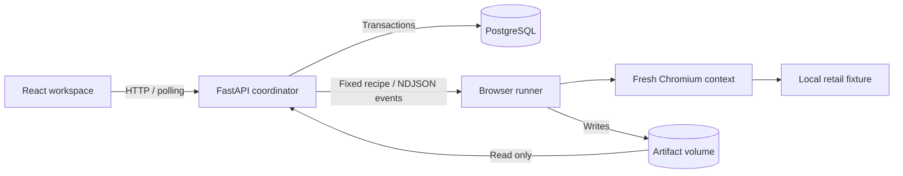

# Architecture — milestones 1–2

One complete path: select a supported report → launch real Chromium → establish a passing baseline → change cart quantity → capture screenshots and DOM observations → compare a trusted contract → persist the outcome.

## Runtime boundaries

The **API** validates the only supported bug ID, applies idempotency keys, limits admission to two active runs, and commits ordered events and terminal outcomes. One coordinator is enforced with a PostgreSQL advisory lock. The API calls a separate runner over HTTP; it never executes submitted commands. The frontend polls persisted state every 650 ms while active, with connection errors and retry feedback. History survives refreshes and API restarts.

The **runner** accepts a UUID for a fixed recipe. It receives no database or inference credentials. Its container has a read-only root filesystem, an artifact volume, temporary storage, memory/PID limits, no added capabilities and no new privileges. It belongs only to an internal Docker network. Browser routing accepts only the local fixture origin and path. There is no caller-controlled URL, script, shell command, or repository path. The browser is Playwright's bundled Chromium; the runner image and Python package use the same version.

This is containment for a trusted recipe on a trusted synthetic fixture. Chromium uses Playwright's default launch arguments, including disabling its own sandbox. **This is not yet a sandbox for untrusted generated code.** Milestone 3 must provide that stronger execution boundary before accepting patches.

The **fixture** is a functional retail UI with add-to-bag and quantity controls, integer-cent pricing, shipping rules, and an intentionally defective subtotal calculation. It accepts no payments or customer data. The manual embedded storefront uses a separate browser session from automation; manipulating it cannot alter automated observations.

## Evidence and outcome contract

Every run has a UUID, supported report ID, timestamps, state, ordered events, optional error, and optional validated result. Each completed result contains baseline and after-action DOM observations, independent expected values, per-assertion comparisons, fixture SHA-256, Chromium version, elapsed time, screenshots, console capture, and a native Playwright trace. Expected pricing is defined in the trusted runner, separately from the storefront calculation. Monetary assertions use cents.

| State | Meaning |
| --- | --- |
| `queued` / `running` | Accepted / browser execution in progress |
| `reproduced` | Passing baseline, successful quantity action, and the exact reported mismatch observed |
| `not_reproduced` | Passing baseline and all after-action pricing assertions passed |
| `error` | Infrastructure, invalid evidence, unexpected mismatch, or timeout; no defect conclusion |
| `cancelled` | Cancellation accepted; incomplete execution has no result |
| `interrupted` | An unfinished run was found after an unclean API restart |

A failing application assertion is a successful **reproduction**, not a verified repair. NVIDIA diagnosis has its own persisted status and execution trail. A structured diagnosis with valid citations is a proposal, not independently established truth. Patch generation, application and repair verification remain out of scope.

Events and status updates share database transactions and row locks. Terminal states cannot be overwritten by late responses. Duplicate idempotency keys return the original run. The API owns and awaits its execution tasks; shutdown cancels them. A 60-second overall budget and a 55-second runner budget bound execution. Restart recovery marks remaining active rows interrupted and retains their partial evidence. Run/artifact access is validated through persisted run identities and an artifact allowlist.

## Data and delivery

SQLAlchemy async sessions use PostgreSQL; Alembic owns schema changes. There is no SQLite fallback or in-memory substitute. The API serves the production React build and immutable fixture on one origin. Compose starts PostgreSQL, a one-shot migration, the runner, and the API in readiness order. The API and development database ports bind only to loopback. Local database credentials are explicitly disposable. There is no authentication or remote hosting yet.

The shared Playwright runtime image avoids maintaining different browser/library environments. The API does not launch the installed browser. A smaller API image is a deferred optimization; working isolation and one reproducible environment matter more at this stage.

## Grounded diagnosis (milestone 2)

A separate `InvestigationManager` extends the existing coordinator; there is no second orchestration engine or repair agent. It admits two investigations, bounds each to 180 seconds, preserves partial evidence, cancels provider work, and marks unfinished diagnoses interrupted after restart. It never changes reproduction status. Reports are bounded to 4,000 characters. Provider calls have a 45-second timeout, one bounded transient retry, a 12-request investigation limit, a conservative 32,768-token input bound and 1,400 output tokens. Rejected outputs are not silently rewritten or replaced.

`NvidiaProvider` is a replaceable async protocol implementation. LangChain Core composes the rendered chat prompt, async provider runnable and Pydantic output parser. The adapter owns transport, retries, response-envelope checks and measured usage. HTTP error bodies and authorization headers are excluded from traces. Runtime settings do not read secret files; only provider settings load the ignored backend credential configuration. Compose injects it into the API only. The runner image contains no environment file and receives no NVIDIA credentials.

### Immutable approved source

The corpus is exactly `fixtures/retail/{cart.js,index.html,styles.css,README.md}` at commit `b44dfbb5c6804638e42d2dcc76565aa8d12aeb2a`. Formatting makes source ranges readable; developer documentation describes normal product behavior without supplying a reference fix. There are four files, 13,983 UTF-8 bytes and 84 chunks. No workbench reports, trusted checks, evaluation labels, fixes, secrets or future commits are ingested. No target developer tests are approved or indexed in this version.

`scripts/freeze_corpus.py` reads only that allowlist from an explicit Git commit and packages source bytes and hashes. Snapshot identity incorporates the commit and file hashes; the fixture digest matches the reproduction runner's file-digest algorithm. The API refuses to investigate a reproduction from another source digest. Older reproduction history and artifacts remain intact; rerun reproduction to investigate the new snapshot.

PostgreSQL stores the entire immutable manifest, source bytes, model-specific index and chunks. Unchanged indexing returns the existing index without new embedding calls; an advisory transaction lock also serializes concurrent initial indexing. A failed initial embedding operation rolls back the incomplete index. Retrieval rejects a mismatched snapshot or embedding model before querying chunks.

### Actual retrieval and context

JavaScript uses Tree-sitter function/top-level boundaries, documentation uses headings, HTML uses section boundaries, and CSS uses rule boundaries. Larger blocks split at line boundaries. PostgreSQL full-text retrieval uses stemming, code-name normalization and `ts_rank_cd`; pgvector performs exact cosine retrieval. Rank lists fuse with reciprocal rank fusion (k=60), then the native NVIDIA reranker orders at most 12 candidates. No ANN index is needed for 84 chunks. The extension is compiled onto the same PostgreSQL 17 Alpine base, retaining the existing data volume and locale family.

Context selection includes complete chunks in rank order within a 4,000-unit budget, counting UTF-8 bytes as a conservative token bound rather than claiming an exact NVIDIA tokenizer count. Source headers, line numbering and separators count toward that bound. Exact selected snippets, candidates, ranks, scores, selection reasons, query, rendered prompt, report, observations and provider calls are persisted. The Retrieval Inspector distinguishes candidates from supplied context. Citation buttons open the persisted source snippet, never the latest working tree.

The model receives report, browser observations and repository context as distinct inputs. Pydantic validates diagnosis/insufficient-evidence structure. Citation checks require supplied source IDs and inclusive ranges within those supplied chunks; the server binds each accepted citation to its frozen path, snapshot and commit. These checks do not verify the reasoning. Out-of-context citations are an explicit invalid-output outcome.

### Evaluation boundary

The frozen eight-query smoke suite is outside the ingestion allowlist. It covers one defect, supporting behaviors and two no-answer questions; paraphrases are not counted as new defects. Live lexical, dense, hybrid and reranked results are retained. A same-model comparison supplies either retrieved chunks or the whole four-file target. Measured results favor simpler lexical retrieval for recall on this corpus; no general RAG benefit or debugging success rate is claimed. Dollar cost is unavailable; reported token counts come from provider responses. See the milestone 2 report.

## Future execution boundary

Future patches must target disposable copies of the approved application and must not modify trusted tests, infrastructure or secret configuration. Generated-code execution, MCP tools, LangGraph repair and independent regression verification remain milestone 3 work requiring approval.
