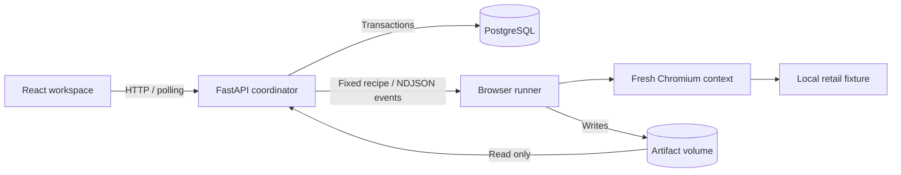

# Architecture — milestone 1

One complete path: select a supported report → launch real Chromium → establish a passing baseline → change cart quantity → capture screenshots and DOM observations → compare a trusted contract → persist the outcome.

## Runtime boundaries

The **API** validates the only supported bug ID, applies idempotency keys, limits admission to two active runs, and commits ordered events and terminal outcomes. One coordinator is enforced with a PostgreSQL advisory lock. The API calls a separate runner over HTTP; it never executes submitted commands. The frontend polls persisted state every 650 ms while active, with connection errors and retry feedback. History survives refreshes and API restarts.

The **runner** accepts a UUID for a fixed recipe. It receives no database or inference credentials. Its container has a read-only root filesystem, an artifact volume, temporary storage, memory/PID limits, no added capabilities and no new privileges. It belongs only to an internal Docker network. Browser routing accepts only the local fixture origin and path. There is no caller-controlled URL, script, shell command, or repository path. The browser is Playwright's bundled Chromium; the runner image and Python package use the same version.

This is containment for a trusted recipe on a trusted synthetic fixture. Chromium uses Playwright's default launch arguments, including disabling its own sandbox. **This is not yet a sandbox for untrusted generated code.** Milestone 3 must provide that stronger execution boundary before accepting patches.

The **fixture** is a functional retail UI with add-to-bag and quantity controls, integer-cent pricing, shipping rules, and an intentionally defective subtotal calculation. It accepts no payments or customer data. The manual embedded storefront uses a separate browser session from automation; manipulating it cannot alter automated observations.

## Evidence and outcome contract

Every run has a UUID, supported report ID, timestamps, state, ordered events, optional error, and optional validated result. Each completed result contains baseline and after-action DOM observations, independent expected values, per-assertion comparisons, fixture SHA-256, Chromium version, elapsed time, screenshots, console capture, and a native Playwright trace. Expected pricing is defined in the trusted runner, separately from the storefront calculation. Monetary assertions use cents.

| State | Meaning |
| --- | --- |
| `queued` / `running` | Accepted / browser execution in progress |
| `reproduced` | Passing baseline, successful quantity action, and the exact reported mismatch observed |
| `not_reproduced` | Passing baseline and all after-action pricing assertions passed |
| `error` | Infrastructure, invalid evidence, unexpected mismatch, or timeout; no defect conclusion |
| `cancelled` | Cancellation accepted; incomplete execution has no result |
| `interrupted` | An unfinished run was found after an unclean API restart |

A failing application assertion is a successful **reproduction**, not a verified repair. No AI diagnosis, patch generation, patch application, or independent repair verification exists in this milestone. The UI explicitly distinguishes current reproduction functionality from future phases.

Events and status updates share database transactions and row locks. Terminal states cannot be overwritten by late responses. Duplicate idempotency keys return the original run. The API owns and awaits its execution tasks; shutdown cancels them. A 60-second overall budget and a 55-second runner budget bound execution. Restart recovery marks remaining active rows interrupted and retains their partial evidence. Run/artifact access is validated through persisted run identities and an artifact allowlist.

## Data and delivery

SQLAlchemy async sessions use PostgreSQL; Alembic owns schema changes. There is no SQLite fallback or in-memory substitute. The API serves the production React build and immutable fixture on one origin. Compose starts PostgreSQL, a one-shot migration, the runner, and the API in readiness order. The API and development database ports bind only to loopback. Local database credentials are explicitly disposable. There is no authentication or remote hosting yet.

The shared Playwright runtime image avoids maintaining different browser/library environments. The API does not launch the installed browser. A smaller API image is a deferred optimization; working isolation and one reproducible environment matter more at this stage.

## Extension seams and leakage control

The runner's versioned Pydantic result and event contracts, separate execution boundary, persisted traces, and report identity form the foundation for later investigation. Milestone 2 should index the retail repository at a specific commit and preserve path/line identities. **Do not index trusted runner expectations, workbench tests, engineering reports, reference patches, hidden tests, or future commits as retrieval context.** No fabricated retrieval inspector or model responses are present now.

Future generated patches must target a disposable copy of the supported fixture only; they must not modify this trusted runner, infrastructure, or regression checks. MCP tool permissions, model adapters, pgvector, and LangGraph belong to their stated milestones, not this foundation.
