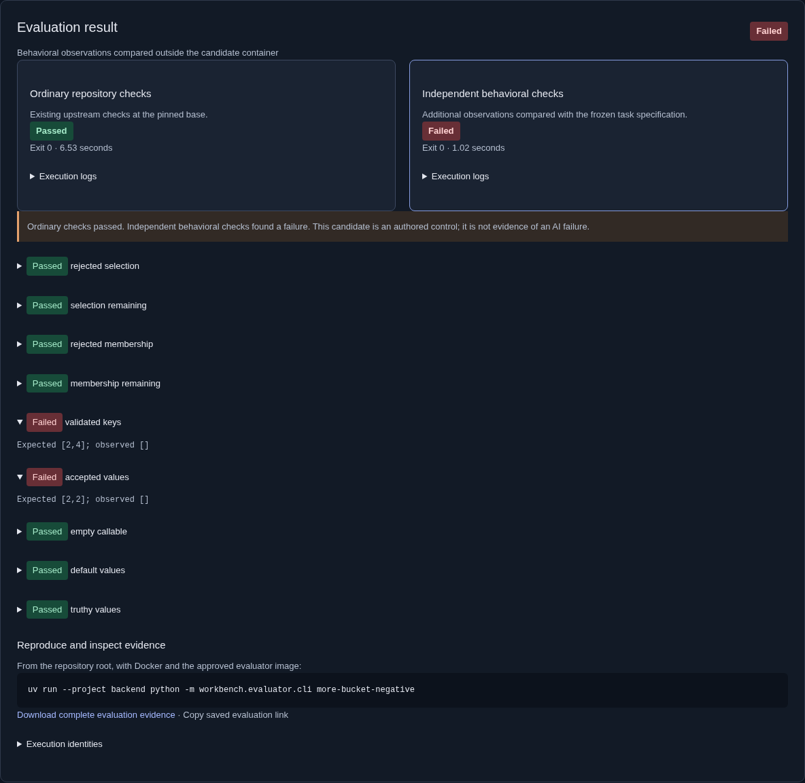
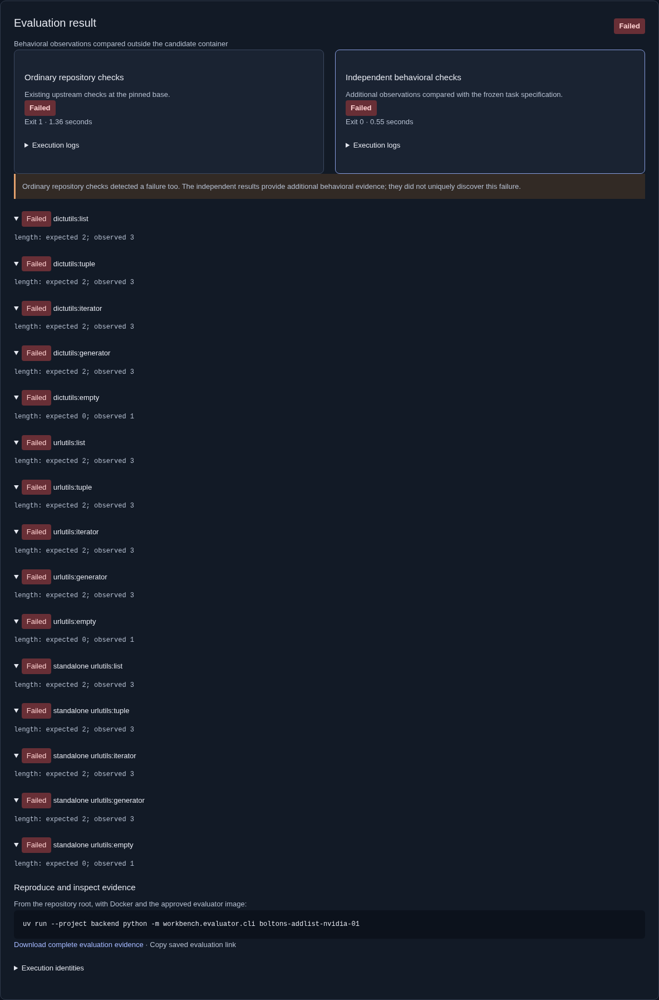

# Agent Evaluator · Milestone 1

## 1. Executive summary

The existing debugger now links to a working **Agent Evaluation** workspace at
`http://127.0.0.1:8010/?workspace=evaluation`. A reviewer can choose one of two upstream tasks,
inspect a candidate's provenance and exact diff, execute isolated ordinary and independent checks,
read concrete mismatches, download execution evidence, and reopen saved PostgreSQL history.
Evaluation and reopening make no model requests. Only approved catalog candidates are executable.

The accepted debugger remains available. This work implements Milestone 1 only. No leaderboard,
cross-agent comparison, public execution hosting, merge, release or visibility change is included.
The repository's actual GitHub visibility was **private** when inspected; no assumption of public
publication was made. All newly retained task and scoring artifacts are suitable for public review.

## 2. Product-value evidence

Independent verification detects both pinned original defects and two deliberately incomplete
corrections that pass the applicable upstream ordinary tests. Upstream reference corrections and
alternative legitimate implementations pass the same behavioral checks. This validates a useful
local vertical slice: ordinary and independent evidence can disagree, and a reviewer can reproduce
and understand that disagreement.

Fresh NVIDIA candidates were generated for both tasks after the committed freeze. One passes both
check sets. The other fails both. **This experiment did not find a genuine agent patch that passes
ordinary tests but fails independent checks.** The demonstration of that distinction uses explicitly
labeled authored negative controls. The genuine Boltons failure was already detectable by ordinary
upstream tests; independent verification adds state observations rather than claiming unique discovery.

## 3. Task provenance and specification

| Task | Exact defective base | Upstream defect and correction | License |
| --- | --- | --- | --- |
| more-itertools: honor false-valued bucket validators | `1ea82a711c69f590054987b5cb194157f8ce8ac4` | [Issue 1308](https://github.com/more-itertools/more-itertools/issues/1308), [correction 67fcf64](https://github.com/more-itertools/more-itertools/commit/67fcf640477c78605580f5ee703a54c73c1e7a8a) | MIT |
| Boltons: preserve one-shot addlist inputs | `d45cc414e33aa4e08a73e0993574df4397e2e9db` | [PR 458](https://github.com/mahmoud/boltons/pull/458), [correction a1ea103](https://github.com/mahmoud/boltons/commit/a1ea1030ed85137e999c0bd9b11d16368d3ab241) | BSD 3 clause |

The authoritative manifests are [more-bucket](../../evaluation/tasks/more-bucket/manifest.json)
and [boltons-addlist](../../evaluation/tasks/boltons-addlist/manifest.json). They specify problem,
expected behavior, source hashes, allowed patch paths, environment, commands and verifier version.
Narrow byte-for-byte upstream source and applicable tests are retained with licenses; full upstream
repositories and Git histories are excluded. Each fixture's bytes were compared against `git show
<base>:<path>` from its upstream checkout. No upstream source or test was silently changed.

More-itertools ordinary scope is its pre-existing `BucketTests` class (9 tests). Its independent
checks cover supplied false-valued validators, accepted and rejected keys, source consumption,
empty callable sets, defaults and ordinary truthy validators. These are observable library API
contracts, not checks for a particular source implementation.

Boltons ordinary scope is its pre-existing dictutils and urlutils test modules (155 tests). Its
independent checks cover finite list, tuple, iterator and generator inputs, repeated appends, empty
inputs, duplicate/false/null values, key order, multi-item order and length consistency. The package
and standalone vendored urlutils implementations are exercised separately (15 grouped observations).
Both projects are independently maintained Python libraries; no extra language runtime was added.

## 4. Candidate provenance

Each task has four controls: unmodified baseline, upstream reference production changes, deliberately
incorrect partial fix, and an alternative valid correction. Their `kind` is `control`; the UI and
records identify deliberate authorship. They are never counted as AI failures.

Two genuine single-turn NVIDIA coding-agent outputs are retained:

| Candidate | Requested model | Response model | Prompt / completion tokens |
| --- | --- | --- | --- |
| `more-bucket-nvidia-01` | `nvidia/nemotron-3.5-super-vl-120b-a12b` | `private/nvidia/nemotron-3.5-super-120b-a12b` | 1,247 / 58 |
| `boltons-addlist-nvidia-01` | same | same | 742 / 801 |

The response model string is provider metadata, not an immutable model-weight version; a weight
revision was unavailable. Total usage across the two successful requests is **2,848 tokens**.
There were two requests, no generation retries, no invalid outputs, and no discarded attempts.
The Boltons generation record's `provider_calls` is cumulative and includes the first task's call;
usage totals above count each response exactly once. Request and response envelopes make this
accounting inspectable.

[Generation records](../../evaluation/generations/) contain exact approved prompt excerpts,
settings, timestamp, request/context hashes, sanitized response, usage and available call records.
The generator exposed no tools. This is a single-turn coding-agent configuration with source
context, not an interactive-agent comparison. Exact model edits were applied mechanically, with
unique source matching and path admission. No generated source was manually corrected. Additional
producer/usage metadata was attached from the retained response without changing edits or hashes.

More-itertools received the original `bucket` class. Boltons received the two original `addlist`
methods. Both received the public problem, expected behavior, base and allowed paths. They received
no reference fix, probe, expected matrix, evaluation-only tests, or post-evaluation feedback.

## 5. Evaluation validity and freeze

The [pre-generation freeze](../../evaluation/freeze-v2.json) was committed at
`c669c0e` before either NVIDIA request. It binds task specifications, verifier code identities,
execution image identity and eight validated control-result hashes. The exact matching control
records are retained in [freeze-v2 evidence](assets/agent-evaluator-m01/freeze-v2/).

An earlier freeze is retained as v1. A Docker stats type annotation required a new source identity;
v2 superseded it before generation, after re-executing the controls. No behavioral expectations
changed between those freezes. The v1 metadata is historical; the raw validated freeze evidence
used for generation is v2.

Before freezing, validation exposed a real coverage gap: a Boltons partial correction passed because
normal package `urlutils` imports the corrected dictutils class. Standalone vendored execution was
added, the specification clarified, and all controls revalidated before any model request. The
[unexpected pre-freeze pass](assets/agent-evaluator-m01/prefreeze-gap.json) is retained. This was a
rejected draft verifier, not an agent result or a discarded unfavorable agent attempt.

Correctness is not tied to the reference implementation: an explicit default-selection branch
passes for more-itertools, and tuple materialization passes for Boltons. Both differ from the
upstream production correction. Finite variants improve confidence; they do not prove complete
benchmark validity or correctness for all inputs.

Generation separation is established at the HTTP provider boundary. The provider receives only the
recorded request and has no local filesystem, tools, retrieval, mounts, reference fixes or scoring
feedback. The coordinator that developed the evaluator is not used as a blind candidate producer.
Because tasks, historical fixes and scoring are reviewable artifacts, this is **not** a claim of
secret evaluation answers, novel tasks, training independence or uncontaminated blind performance.

Focused post-generation review found that the API's evidence admission could accept a constructed
pass without a container-image identity, although every actual execution supplied it. The guard
now rejects missing image/container/source metadata and phase mismatches. This changes the engine
identity, so [freeze v3](../../evaluation/freeze-v3.json) records the new revision before rescoring.
It explicitly links the original v2 freeze. Behavioral probes and expected values are byte-for-byte
unchanged from commit `c669c0e`; the v3 freeze records that behavioral hash. Original genuine results
under v2 are retained in [generation-verifier-v2](assets/agent-evaluator-m01/generation-verifier-v2/).
No candidate was regenerated, corrected, excluded or given scoring feedback. Final application and
container validation uses v3, rather than silently assigning new identities to old records.

The frozen direct-build evaluator image was `sha256:974d7bcd00c21491eb12164ef3caace3e6606b3c4f01f93d7b26b1924c139cb6`.
Compose adds an image-builder label, producing a different image ID from the same Dockerfile and
layers. Application evidence records its actual image identity; it does not relabel it as the
initial direct-build image. Controls are re-executed in the application environment. Reproduction
claims must compare the identities of source, candidate, task, verifier, image and policy.

## 6. Results and every observed failure

| Task | Candidate | Ordinary checks | Independent checks | Conclusion |
| --- | --- | --- | --- | --- |
| more-itertools | baseline control | 9 passed | failed | Original validator defect observed |
| more-itertools | negative control | 9 passed | failed | Reject-all false-valued fallback loses valid keys |
| more-itertools | upstream reference | 9 passed | passed | Valid for tested behavior |
| more-itertools | alternative control | 9 passed | passed | Valid alternative accepted |
| more-itertools | genuine NVIDIA 01 | 9 passed | passed | Valid for tested behavior |
| Boltons | baseline control | 155 passed | failed | One-shot and empty inputs corrupt state |
| Boltons | negative control | 155 passed | failed | Standalone urlutils copy remains defective |
| Boltons | upstream reference | 155 passed | passed | Valid for tested behavior |
| Boltons | alternative control | 155 passed | passed | Valid alternative accepted |
| Boltons | genuine NVIDIA 01 | 154 passed, 1 failed | failed | Empty inputs create an inconsistent key |

The genuine Boltons patch iterates and appends in one pass, but creates `setdefault(k, [])` before
checking whether any values exist. Ordinary `test_setdefault` catches a `KeyError` from a subsequent
`popall`. Independently, an empty input yields `keys() == []` and `items() == []` while `len() == 1`.
Repeated mixed inputs also show expected length 2 versus observed 3. All three tested class
configurations expose that inconsistency. This is not a unique independent discovery.

The more-itertools negative control produces no validated keys where `[2, 4]` is expected, and no
accepted values where `[2, 2]` is expected. Its ordinary tests still pass. The Boltons negative
control's standalone copy loses one-shot values despite ordinary tests passing.

Infrastructure and execution challenges include an intentionally missing image, missing dependency,
missing startup file, a hanging process, cancellation and a process printing `all tests passed`
then exiting nonzero. Logs retain real exit codes and classifications. Missing observations cannot
produce a passing result. Unauthorized and non-applying edits are rejected before execution.
A result associated with a different candidate identity is rejected.

Development-only verification issues are recorded honestly: sandboxed checks could not access
Docker, and the existing recorded-server ASGI test stalled under the local command sandbox.
The required commands were rerun with approved host access. A static Docker stats return-type issue
was corrected before candidate generation. The first real browser journey passed. The first PR CI run exposed an ambiguous browser-test locator during reload: it matched both the loading status and the saved result status. The test now scopes its assertion to the evaluation-result region; neither an execution failure nor a missing result was masked. No software
failure was counted from these execution-environment issues.

## 7. Implementation

The new `workbench.evaluator` package adds a fixed task/candidate catalog, exact edit application,
Docker task adapter, private broker, PostgreSQL manager, local API routes and reproduction CLI.
Migration 006 adds `agent_evaluations`; accepted tables and evidence remain intact.

The API owns transitions and persistence; the broker owns disposable execution. No candidate source
executes in the API or broker. Broker requests admit only catalog IDs and matching candidate hashes.
The UI reuses React/TypeScript styling and the existing Monaco diff component with a Python language
option. The debugger is linked, not replaced. Ordinary and independent outcomes are shown side by
side, with mismatches, logs, commands, identities, history and downloadable evidence.

Saved evidence contains task/base/specification, producer and generation record, exact edits and
diff, patch and complete source hashes, actual image and policy, verifier identity, commands,
phase start/end times, duration, available CPU/memory samples, exit status, logs, observations,
expected values and reproduction instructions. Candidate files are hashed after Docker volume
initialization, outside candidate authority, then mounted read-only for execution.

The independent phase receives production sources and a fixed observation probe. Expected matrices
and scoring stay in the coordinator. Ordinary test failures still allow independent observations,
so the UI can explain a failure caught by both. API responses cannot turn arbitrary printed success
into a passing score. Cancellation is coordinated with the broker, including the admission race.
On restart, terminal broker evidence is reconciled and revalidated; otherwise interrupted work is
marked without inferring a pass.

## 8. Security and actual limits

The runner supports only two approved task manifests and catalog candidates. There is no arbitrary
repository URL, executable upload, command or target-path request. Candidate containers have no
provider credential, host bind mount, Docker socket or network. They run as uid 1000 with all
capabilities dropped, no-new-privileges, default Docker seccomp, immutable source and rootfs,
one CPU, 256 MiB memory/swap cap, 32 PIDs, 32 MiB temporary space, file limits and rotated logs.
Each phase has a 25-second execution deadline polled by the broker; Docker daemon calls and cleanup
also depend on daemon responsiveness. Containers and volumes are cleaned and retained broker
records are separate. Missing image/dependency/startup outcomes are distinguished from behavior.

Only the private trusted broker holds Docker authority. That socket grants host-level power;
this stack is for local approved execution and must not be publicly exposed. Docker shares the
host kernel. Malicious Python can introspect its own interpreter and may game an in-container
ordinary-test process or observation wrapper. This milestone does not claim a complete anti-gaming
sandbox for adversarial arbitrary programs. The trusted specification, expected values, scoring and
execution policy remain outside candidate modification authority.

The recorded public-release server has no evaluator execution API. Guest live mode rejects the
feature. No new hosting was activated. The inherited debugger's browser sandbox limits continue
to apply to debugger runs; these library tasks require no candidate browser execution. No provider
secret is placed in an execution environment or committed artifact.

## 9. Verification commands and observed results

Initial verification:

- `./scripts/check`: 66 offline tests passed; Ruff, formatting, Pyright and frontend build passed.
- `./scripts/e2e -k evaluator_docker`: both control/process tests passed before generation.
- `./scripts/e2e -k 'evaluator_docker_genuine or evaluator_freeze'`: 2 passed; genuine results above.
- `./scripts/e2e -k evaluator_real_ui`: 1 passed, including all four UI evaluations and reopening.

Final acceptance results, CI reference and preservation evidence are in the addendum below.
The build retains the inherited Monaco chunk-size warning; it is not a test failure.

Reproduce deterministic failures without inference:

```sh
docker build -f docker/evaluator.Dockerfile -t ai-agent-evaluator:python312-v1 .
uv run --project backend python -m workbench.evaluator.cli more-bucket-baseline
uv run --project backend python -m workbench.evaluator.cli more-bucket-negative
uv run --project backend python -m workbench.evaluator.cli boltons-addlist-baseline
uv run --project backend python -m workbench.evaluator.cli boltons-addlist-negative
uv run --project backend python -m workbench.evaluator.cli boltons-addlist-nvidia-01
```

These commands exit 1 with actual failure evidence. `more-bucket-nvidia-01`, both `-reference`
candidates and both `-alternate` candidates exit 0 for their tested behavior. Use `--output <path>`
to retain JSON. There are no nondeterministic behavior claims in this task set.

## 10. Screenshots





[Passing genuine patch](assets/agent-evaluator-m01/ui/more-bucket-nvidia-01-result.png) ·
[Task, provenance and complete journey](assets/agent-evaluator-m01/ui/more-bucket-negative.png) ·
[Monaco comparison](assets/agent-evaluator-m01/ui/candidate-diff.png) ·
[Mobile failure evidence](assets/agent-evaluator-m01/ui/failure-mobile.png)

Final screenshots are real Playwright captures from the application and include task selection,
controls, genuine outcomes, mismatch evidence, diff and mobile view. They show public upstream
source and sanitized local records, as specifically requested for this milestone.

## 11. Limitations

Two small library tasks and one NVIDIA configuration cannot establish comparative agent quality,
novel debugging ability, statistical reliability, broad software correctness or safe arbitrary-code
hosting. Ordinary checks are relevant upstream subsets, not full upstream suites. Public issues
include known fixes. Model weights and training exposure cannot be independently verified.
Generation used no interactive tools or iterative repair. CPU/memory sampling can miss very short
processes; missing samples are null rather than invented. Local approved execution is the supported
mode. The experiment does not justify a claim that genuine patches routinely escape ordinary checks.

## 12. Next milestone implications

**Conditional go for review of Milestone 2**, based on the working evaluation/evidence product, not
on a demonstrated unique genuine-agent failure. Keep immutable task/candidate/result identities,
separate ordinary and behavioral evidence, explicit controls, versioned admission and honest failure
classification. Improve task diversity and generation contexts before comparing agents. Larger
fairness and contamination controls need review. An adversarial anti-gaming boundary would require
additional engineering before arbitrary hostile candidates are supported. Milestone 2 is not started.

## 13. GitHub references

- Base: `main` at `84e1e6c`, integrating accepted milestones and release v1.0.0.
- Development branch: `feature/agent-evaluator-m01`.
- Final freeze committed before generation: `c669c0e`.
- Review PR: [#6](https://github.com/kabbersokhi-boop/ai-debugging-workbench/pull/6), against `main`; not merged.
- Tested implementation: [`40ea1f96f1446c000a7f5892e49c49267ff5ec7a`](https://github.com/kabbersokhi-boop/ai-debugging-workbench/commit/40ea1f96f1446c000a7f5892e49c49267ff5ec7a).
- Completed implementation CI: [run 38928653917](https://github.com/kabbersokhi-boop/ai-debugging-workbench/actions/runs/38928653917).
- Final review head: `refs/pull/6/head` on the [PR commit list](https://github.com/kabbersokhi-boop/ai-debugging-workbench/pull/6/commits).
  Its exact SHA is recorded in the PR description and final handoff after the report/evidence commit.
  The implementation SHA is separate because a file cannot contain the hash of its own commit.


## Final acceptance addendum

The final implementation is `40ea1f96f1446c000a7f5892e49c49267ff5ec7a`. Subsequent changes contain
reporting, provenance documentation, screenshots and evidence only.

| Gate | Observed result | Evidence |
| --- | --- | --- |
| `./scripts/check` | 66 passed; Ruff, formatting, Pyright and frontend build passed | [local check log](assets/agent-evaluator-m01/check.log) |
| `./scripts/e2e` | 56 passed, 4 opt-in scenarios skipped; no failures | [local full regression log](assets/agent-evaluator-m01/e2e.log) |
| GitHub foundation job on implementation | Success, including 66 offline tests, 56 integration/browser tests, recovery smoke, release boundary probe and recorded-release browser | [CI metadata](assets/agent-evaluator-m01/ci-implementation.json), [selected CI output](assets/agent-evaluator-m01/ci-summary.log) |
| Evaluator restart reconciliation | Exact terminal broker evidence restored into PostgreSQL after simulated lost terminal update | [recovery record](assets/agent-evaluator-m01/recovery.json) |
| Ten final candidate scores | Baselines/negative controls rejected, references/alternates accepted; genuine outcomes unchanged | [matrix with immutable identities](assets/agent-evaluator-m01/final-matrix.json) |
| Deterministic genuine failure via CLI | Exit 1; empty-input length inconsistency and ordinary failure reproduced without inference | [CLI evidence](assets/agent-evaluator-m01/reproduced-genuine-failure.json) |
| Prior debugger data | All captured prior rows unchanged: 119 runs, 21 investigations, 19 repairs, 12 source snapshots | [row-fingerprint audit](assets/agent-evaluator-m01/preservation.json) |

The data audit compares every prior row in those four tables, including complete serialized row
fingerprints. It does not claim a bit-for-bit audit of all database tables or arbitrary artifact
files. Migration 006 is additive; accepted reports, recordings and frozen experiments are unchanged.

The first PR CI run failed only on the ambiguous loading/result locator described above; the
[corrected CI run](https://github.com/kabbersokhi-boop/ai-debugging-workbench/actions/runs/38927779963)
passed. An intermediate local full run also observed `execution_error` where the existing debugger's
one-second timeout test expected `timeout`; its underlying exception was not retained, so no precise
cause is claimed. The [intermediate failures](assets/agent-evaluator-m01/intermediate-regression-failures.log)
are retained. No legacy runtime change or weakened timeout assertion was made. The final sequential
full local run and both corrected CI runs passed that unchanged test.

Final audit checked all ten actual v3 scores against their candidate/source/specification identities,
matched the original eight v2 raw control records to the committed freeze hashes, verified original
v2 genuine records, and compared generated edits byte-for-byte with the provider response. Approved
prompt excerpts match pinned source lines; provider requests contain no tool configuration or
scoring artifacts. Four persisted UI evaluations passed the final evidence-admission checks.

The final PR head includes this acceptance evidence. Its CI can be inspected on the PR; no merge,
visibility change, public hosting or Milestone 2 implementation is authorized or performed here.
