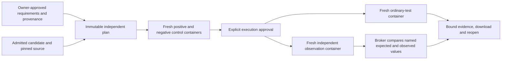

# Generalized Patch Audit G2 — independent behavioral requirements

G2 extends the accepted, unmerged G1 workflow with separately justified behavioral
requirements. It does not infer a software specification. **Zero genuine additional
defect discoveries are claimed.** The negative patches below are authored controls.

## Architecture and trust

The selected mechanism is a bounded declarative function-call contract: finite JSON
arguments, a public Python/Node callable, named assertions and exact canonical JSON
expected values. The private broker compares actual observations against expectations.
This small contract has a more inspectable trust boundary than arbitrary owner scripts.
Python 3.12 and Node 22 are supported; arbitrary verifier bundles, exception assertions,
browser APIs, non-JSON objects and automatic dependency acquisition are unsupported.



G1 intake, production-only patch admission, PostgreSQL records, single-capacity broker,
local-only API, cancellation, terminal evidence and recovery are reused. Two additive,
immutable database tables store requirements and independent plans. Runs use the existing
audit table and manager. No second backend or orchestration framework was introduced.

The candidate source and trusted observation adapter occupy **separate read-only named
volumes**. Expected values, provenance, approval and comparison code stay outside the
candidate's container. Actual initialized source and verifier bytes are read back and
hashed before execution. Ordinary and independent phases rebuild the identical admitted
candidate in fresh containers and volumes; no installed artifacts or scratch state carry
between them. Adapter sources are fixed application material, captured in the approved
plan, and must match their approved hashes. User-provided adapter replacements are rejected.

Containers run without network, credentials, Docker socket or host binds; UID 1000,
read-only root and inputs, dropped capabilities, no new privileges, 1 CPU, 512 MiB memory
and swap, 64 processes, 128 MiB scratch, 8 MiB tmp/shm, 16 MiB file limit and bounded logs.
Each independent plan allows 1–120 command seconds and only explicitly approved offline
setup. Cleanup must be confirmed before completed observations count as results.

Docker shares the host kernel. An intentionally adversarial candidate can tamper with
in-process observation machinery or forge stdout; a read-only checker does not eliminate
that limitation. This is an owner-operated behavioral checking tool, not a secure public
malicious-code runner. Use a disposable isolated VM for adversarial inputs. The public
recorded server receives no execution routes, package dependencies or Docker authority.

## Versioned contract and validation

- `behavioral-requirement-v1`: source snapshot identity, statement, expected behavior,
  supported domain, assumptions, ambiguities, provenance origin/reference/excerpt/hash,
  independent justification, and explicit owner approval. These are owner attestations;
  the application cannot establish whether an arbitrary prose specification is true.
- `independent-plan-v1`: exact source/candidate/import and ordinary-plan identities,
  requirement IDs, module/export, ordered named JSON assertions, verifier sources/hashes,
  independent runtime image identity, offline setup, timeout, sandbox-policy hash and
  `all-named-canonical-json-equalities-v1` interpretation. Its content hash is its ID.
- `repository-independent-result-v1`: stage, exact plan/source/candidate/engine binding,
  validation controls or both execution phases, actual commands/runtime/security policy,
  observed file hashes, bounded logs, input/expected/observed assertions, timestamps and
  confirmed cleanup. The enclosing saved evidence retains approvals and validation proof.

Plan admission rejects missing/unused requirements, duplicate names, contradictory expected
results for identical inputs, unknown formats, unsafe paths, arbitrary adapters, excessive
JSON, ambiguous or unapproved requirements and model-only hypotheses. It uses typed argv
and G1 policy validation. Candidate patches cannot target the external verifier volume.

Before execution, the owner approves two synthetic controls. Both use the same selected
runtime, fixed adapter, JSON observation protocol, named assertions and broker comparison.
An external synthetic implementation returns the declared expected values; the negative
implementation returns structurally different values. Every positive assertion must pass
and every negative assertion must fail. Their full executions are retained and revalidated
when authorizing the candidate run. A changed plan/candidate/image needs its own validation.

Controls prove the mechanism distinguishes its authored examples. They do not prove the
specification, the real target's importability, completeness, or defect-discovery accuracy.
Target import/serialization failures are `check_execution_failed`, not behavioral failures.
Unavailable offline setup is `verifier_preparation_failed`; invalid/missing/truncated/
duplicated observations are `invalid_evidence`. No zero-exit process can bypass the named
assertion count, IDs, binding, expected-value comparison or cleanup checks. Timeouts,
cancellation and infrastructure failures retain distinct nonpassing statuses.

An execution can show ordinary `tests_passed` beside independent `assertions_failed`.
`checks_passed` means only that every named assertion matched its approved expectation.
There is no overall verified verdict or confidence score. Assertions execute in declared
order in one fresh independent environment. Exact JSON equality is intentionally narrower
than semantic equivalence; this plan can reject alternate valid encodings if they differ
from the owner-approved literal outputs. It does not establish behavior outside its domain.

## Stage A and the bounded external trial

Stage A passed **108 targeted offline tests** and **5 actual Docker integration tests**
before the real trial was declared. Expanded controls subsequently covered actual checker
write attempts, setup failure and timeout. No new inference was performed.

Trial declaration commit: `2f47001`. The unchanged manifest and patches are in
[`evaluation/repository-examples/g2`](../../evaluation/repository-examples/g2/examples.json).
It predeclares exactly four candidate/check combinations on two repositories before scoring.
The source README documents are retained with hashes and checked against freshly fetched
Git tree/blob-verified source. They are provenance evidence, never executable instructions.

| Repository and immutable base | Candidate | Ordinary tests | Independent checks |
|---|---|---|---|
| `hynek/first` · `106ee3cf389cf2bb76f2816bf22a845c44275f94` | G1 historical production patch | 3 passed | 4 passed |
| Same Python base | Authored string-skipping regression | 3 passed | 3 passed / 1 failed |
| `component/escape-html` · `b42947eefa79efff01b3fe988c4c7e7b051ec8d8` | G1 historically sourced alternative | 30 passed | 4 passed |
| Same Node base | Authored Unicode-prefix escaping bypass | 30 passed | 2 passed / 2 failed |

Python's README specifies first-truthy selection. The negative control returns `42` for
`[0, false, "ready", 42]` instead of `"ready"`. Node's README specifies escaping the five
HTML special characters. The negative control leaves `é<&` and `🚀<go>` unescaped. The
ordinary upstream tests remain unchanged. Requirements and check examples were fixed
before scoring; no post hoc failure search or model-generated candidates were used.

These results establish the bounded mechanism on real repositories. **Zero demonstrated
additional genuine detections**: authored controls, historical examples and reruns are
not discoveries. The original Boltons detection remains historical evidence only.

Reproduce with the private local stack and built Python/Node runtime presets:

```bash
uv run --project backend python scripts/validate_repository_g2.py \
  --base-url http://127.0.0.1:8010 --confirm-local-execution
./scripts/check
./scripts/e2e
./scripts/recovery-smoke
uv run --project backend python scripts/check_release.py
```

Without `--confirm-local-execution`, the trial script prepares inspectable reviews only.
It never imports or executes repository code on the host. Ordinary commands are the full
upstream `python -m pytest -q test_first.py` and
`node /opt/test-tools/node_modules/mocha/bin/mocha.js test/index.js`. The fixed independent
commands are `python -I -B /verifier/probe.py` and `node /verifier/probe.cjs`.

## Delivery evidence and review recommendation

The complete local UI supports requirement editing, explicit provenance approval, plan
inspection, synthetic validation, a separate execution approval, both outcome layers,
meaningful expected/observed failures, download and exact saved-result reopening. New
candidate/plan selection invalidates previous results and approvals. Model suggestions
are deferred: deterministic fixtures prove that model-only proposals cannot authorize
scoring, but no suggestion agent or model endpoint was added. The core works without an LLM.

Development failures are retained separately from accepted results. The first new test
fixture passed a runtime argument twice; it was corrected without weakening assertions.
The first browser attempt overlapped an external run on the single-capacity broker; the
serialized journey passed after adding explicit admission-response checks.

Final implementation/review SHAs, CI references, full-suite results, preservation audit
and sanitized browser evidence are recorded in the completion evidence and PR handoff.
This document will be finalized after those acceptance runs finish.

Recommendation is contingent on those gates: **GO for bounded G3 design after G2 review**,
not for claims of general detection accuracy. G3 must independently validate specifications,
oracle quality and a prospectively declared real-candidate evaluation. No G3 work, merge,
release, deployment, new model call or frozen historical-result change is part of G2.
