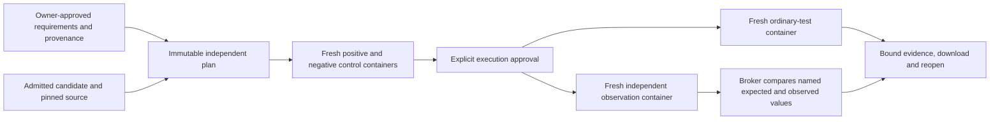

# Generalized Patch Audit G2 — independent behavioral requirements

**Review correction:** the original Node observer retained mutable references.
`json-observer-v2` now snapshots each completed call. Original G2 records remain under
their original verifier identity; see [the focused correction](#observation-integrity-review-correction).

G2 extends the accepted, unmerged G1 workflow with separately justified behavioral
requirements. It does not infer a software specification. **Zero genuine additional
defect discoveries are claimed.** The negative patches below are authored controls.

## Architecture and trust

The selected mechanism is a bounded declarative function-call contract: finite JSON
arguments, a public Python/Node callable, named assertions and exact canonical JSON
expected values. The private broker compares actual observations against expectations.
This small contract has a more inspectable trust boundary than arbitrary owner scripts.
Python 3.12 and Node 22 are supported; arbitrary verifier bundles, exception assertions,
browser APIs, non-JSON objects and automatic dependency acquisition are unsupported.



G1 intake, production-only patch admission, PostgreSQL records, single-capacity broker,
local-only API, cancellation, terminal evidence and recovery are reused. Two additive,
immutable database tables store requirements and independent plans. Runs use the existing
audit table and manager. No second backend or orchestration framework was introduced.

The candidate source and trusted observation adapter occupy **separate read-only named
volumes**. Expected values, provenance, approval and comparison code stay outside the
candidate's scored container. Synthetic control templates necessarily encode their known
outputs; the scored candidate input manifest contains no expected values. Actual initialized source and verifier bytes are read back and
hashed before execution. Ordinary and independent phases rebuild the identical admitted
candidate in fresh containers and volumes; no installed artifacts or scratch state carry
between them. Adapter sources are fixed application material, captured in the approved
plan, and must match their approved hashes. User-provided adapter replacements are rejected.

Containers run without network, credentials, Docker socket or host binds; UID 1000,
read-only root and inputs, dropped capabilities, no new privileges, 1 CPU, 512 MiB memory
and swap, 64 processes, 128 MiB scratch, 8 MiB tmp/shm, 16 MiB file limit and bounded logs.
Each independent plan allows 1–120 command seconds and only explicitly approved offline
setup. Cleanup must be confirmed before completed observations count as results.

Docker shares the host kernel. An intentionally adversarial candidate can tamper with
in-process observation machinery or forge stdout; a read-only checker does not eliminate
that limitation. This is an owner-operated behavioral checking tool, not a secure public
malicious-code runner. Use a disposable isolated VM for adversarial inputs. The public
recorded server receives no execution routes, package dependencies or Docker authority.

## Versioned contract and validation

- `behavioral-requirement-v1`: source snapshot identity, statement, expected behavior,
  supported domain, assumptions, ambiguities, provenance origin/reference/excerpt/hash,
  independent justification, and explicit owner approval. These are owner attestations;
  the application cannot establish whether an arbitrary prose specification is true.
- `independent-plan-v1`: exact source/candidate/import and ordinary-plan identities,
  requirement IDs, module/export, ordered named JSON assertions, verifier sources/hashes,
  independent runtime image identity, offline setup, timeout, sandbox-policy hash and
  `all-named-canonical-json-equalities-v1` interpretation. Its content hash is its ID.
- `repository-independent-result-v1`: stage, exact plan/source/candidate/engine binding,
  validation controls or both execution phases, actual commands/runtime/security policy,
  observed file hashes, bounded logs, input/expected/observed assertions, timestamps and
  confirmed cleanup. The enclosing saved evidence retains approvals and validation proof.

Plan admission rejects missing/unused requirements, duplicate names, contradictory expected
results for identical inputs, unknown formats, unsafe paths, arbitrary adapters, excessive
JSON, ambiguous or unapproved requirements and model-only hypotheses. It uses typed argv
and G1 policy validation. Candidate patches cannot target the external verifier volume.

Before execution, the owner approves two synthetic controls. Both use the same selected
runtime, fixed adapter, JSON observation protocol, named assertions and broker comparison.
An external synthetic implementation returns the declared expected values; the negative
implementation returns structurally different values. Every positive assertion must pass
and every negative assertion must fail. Their full executions are retained and revalidated
when authorizing the candidate run. A changed plan/candidate/image needs its own validation.

Controls prove the mechanism distinguishes its authored examples. They do not prove the
specification, the real target's importability, completeness, or defect-discovery accuracy.
Target import/serialization failures are `check_execution_failed`, not behavioral failures.
Unavailable offline setup is `verifier_preparation_failed`; invalid/missing/truncated/
duplicated observations are `invalid_evidence`. No zero-exit process can bypass the named
assertion count, IDs, binding, expected-value comparison or cleanup checks. Timeouts,
cancellation and infrastructure failures retain distinct nonpassing statuses.

An execution can show ordinary `tests_passed` beside independent `assertions_failed`.
`checks_passed` means only that every named assertion matched its approved expectation.
There is no overall verified verdict or confidence score. Assertions execute in declared
order in one fresh independent environment. Exact JSON equality is intentionally narrower
than semantic equivalence; this plan can reject alternate valid encodings if they differ
from the owner-approved literal outputs. It does not establish behavior outside its domain.

## Stage A and the bounded external trial

Stage A passed **108 targeted offline tests** and **5 actual Docker integration tests**
before the real trial was declared. Expanded controls subsequently covered actual checker
write attempts, setup failure and timeout. No new inference was performed.

Trial declaration commit: `2f47001`. The unchanged manifest and patches are in
[`evaluation/repository-examples/g2`](../../evaluation/repository-examples/g2/examples.json).
It predeclares exactly four candidate/check combinations on two repositories before scoring.
The source README documents are retained with hashes and checked against freshly fetched
Git tree/blob-verified source. They are provenance evidence, never executable instructions.

| Repository and immutable base | Candidate | Ordinary tests | Independent checks |
|---|---|---|---|
| `hynek/first` · `106ee3cf389cf2bb76f2816bf22a845c44275f94` | G1 historical production patch | 3 passed | 4 passed |
| Same Python base | Authored string-skipping regression | 3 passed | 3 passed / 1 failed |
| `component/escape-html` · `b42947eefa79efff01b3fe988c4c7e7b051ec8d8` | G1 historically sourced alternative | 30 passed | 4 passed |
| Same Node base | Authored Unicode-prefix escaping bypass | 30 passed | 2 passed / 2 failed |

Python's README specifies first-truthy selection. The negative control returns `42` for
`[0, false, "ready", 42]` instead of `"ready"`. Node's README specifies escaping the five
HTML special characters. The negative control leaves `é<&` and `🚀<go>` unescaped. The
ordinary upstream tests remain unchanged. Requirements and check examples were fixed
before scoring; no post hoc failure search or model-generated candidates were used.

These results establish the bounded mechanism on real repositories. **Zero demonstrated
additional genuine detections**: authored controls, historical examples and reruns are
not discoveries. The original Boltons detection remains historical evidence only.

Reproduce with the private local stack and built Python/Node runtime presets:

```bash
uv run --project backend python scripts/validate_repository_g2.py \
  --base-url http://127.0.0.1:8010 --confirm-local-execution
./scripts/check
./scripts/e2e
./scripts/recovery-smoke
uv run --project backend python scripts/check_release.py
```

Without `--confirm-local-execution`, the trial script prepares inspectable reviews only.
It never imports or executes repository code on the host. Ordinary commands are the full
upstream `python -m pytest -q test_first.py` and
`node /opt/test-tools/node_modules/mocha/bin/mocha.js test/index.js`. The fixed independent
commands are `python -I -B /verifier/probe.py` and `node /verifier/probe.cjs`.

## Delivery evidence and review recommendation

The complete local UI supports requirement editing, explicit provenance approval, plan
inspection, synthetic validation, a separate execution approval, both outcome layers,
meaningful expected/observed failures, download and exact saved-result reopening. New
candidate/plan selection invalidates previous results and approvals. Model suggestions
are deferred: deterministic fixtures prove that model-only proposals cannot authorize
scoring, but no suggestion agent or model endpoint was added. The core works without an LLM.

Development failures are retained separately from accepted results. The first new test
fixture passed a runtime argument twice; it was corrected without weakening assertions.
The first browser attempt overlapped an external run on the single-capacity broker; the
serialized journey passed after adding explicit admission-response checks.

## Original G2 acceptance evidence (preserved)

Tested implementation: `cc044cb00de771621efe96793e3953825301da0b`.
[Stacked G2 PR #13](https://github.com/kabbersokhi-boop/ai-debugging-workbench/pull/13)
is based on the accepted, unmerged G1 head `9179b44ddd794137abdf6beb555390787044836d`.
Original review head: `ff6e988122afdabbb19c853775a3dfa2c1d096fe`. That original
report/evidence commit added no execution code after its tested implementation.

| Acceptance check | Actual result and retained evidence |
|---|---|
| Offline/static/build | **234 passed**, Ruff/Pyright/frontend build passed; [log](assets/generalized-patch-audit-g02/accepted/check.log). Existing Monaco size warning retained. |
| Full CI integration | **82 passed, 4 existing opt-ins skipped**; [implementation CI](https://github.com/kabbersokhi-boop/ai-debugging-workbench/actions/runs/39821440693), [exact counts](assets/generalized-patch-audit-g02/accepted/ci-implementation.json). Includes G1, prepared Patch Audit, debugger, new G2, real Docker and browser tests. |
| Final local browser checks | **2 passed**: G1 ordinary-only approval/download/reopen and G2 requirements/provenance/approval/failure inspection; [log](assets/generalized-patch-audit-g02/accepted/browser-approval.log). |
| Actual external trials | All four predeclared outcomes matched; [execution log](assets/generalized-patch-audit-g02/accepted/external.log), [eight-record index](assets/generalized-patch-audit-g02/evidence-index.json). |
| Saved real results after recovery | All four reopened, downloaded and reloaded identically, with no new scoring; [browser audit](assets/generalized-patch-audit-g02/accepted/browser/audit.json). |
| Cancellation/restart | G2 explicit approval/cancel/terminal recovery/missing evidence passed; [G2 evidence](assets/generalized-patch-audit-g02/accepted/recovery.json). Debugger recovery smoke passed; [log](assets/generalized-patch-audit-g02/accepted/recovery-smoke.log). |
| Actual recorded boundary | No execution modules, socket, credentials, host mounts or generalized routes; [container audit](assets/generalized-patch-audit-g02/accepted/recorded-boundary.json). Both recorded browser journeys passed; [log](assets/generalized-patch-audit-g02/accepted/recorded-browser.log). |
| Execution/preservation audit | Eight records revalidated; **16 distinct execution environments**, **44 recorded resources confirmed absent**, no remaining evaluator resources, immutable database triggers, **1,204 historical files unchanged**; [audit](assets/generalized-patch-audit-g02/accepted/completion-audit.json). Running backend engines and served frontend matched the implementation; [runtime audit](assets/generalized-patch-audit-g02/accepted/runtime-audit.json). |

The first full local run had 81 passes and one ambiguous approval locator; the exact
approval selector was corrected. Another full local run had 81 passes and one genuine
source-initializer cleanup infrastructure error before tests ran. The existing 20-second
confirmation limit was reached; final cleanup subsequently confirmed both resources absent.
The result correctly remained nonpassing. No timeout, security bound or assertion was
relaxed. [Raw local failure/evidence and CI host-image correction](assets/generalized-patch-audit-g02/development/README.md)
are retained alongside the passing CI and targeted final local checks. Ubuntu 24.04 is
explicitly pinned because `ubuntu-latest` moved to unsupported Ubuntu 26.04 for Playwright 1.58.

Sanitized captures show actual saved G2 results and visible requirement provenance:
[Python positive](assets/generalized-patch-audit-g02/accepted/browser/python-positive.png),
[Python authored negative](assets/generalized-patch-audit-g02/accepted/browser/python-negative.png),
[Node positive](assets/generalized-patch-audit-g02/accepted/browser/node-positive.png),
[Node authored negative](assets/generalized-patch-audit-g02/accepted/browser/node-negative.png).
[Local control/approval capture](assets/generalized-patch-audit-g02/accepted/synthetic-browser/validated-plan.png)
uses a labeled synthetic fixture.

Both positive external examples passed; this small set is not a false-positive-rate
estimate. No unresolved ambiguity was approved for these trials. Literal JSON contracts
and owner-attested provenance remain limits, not automatically discovered specifications.

Acceptance A–M is supported by the reusable adapters and versioned records (A/B), actual
read-only checker write rejection (C), explicit approval/validated-control gates (D/E),
fresh source-bound environments (F), both real runtimes and controls (G/H), nonpassing
invalid/setup/timeout/infrastructure cases (I), exact saved evidence (J), complete CI and
preservation checks (K), the actual recorded boundary (L), and the explicit zero-discovery
claim with unchanged predeclaration (M). The SHA256 artifact manifest permits independent
integrity checking; hashes are content identities, not signatures authenticating arbitrary
owner-supplied evidence.

Original recommendation, before the blocking review finding: **GO for bounded G3 design
after G2 engineering review.** The reusable mechanism was considered ready;
general defect-detection accuracy has not been established. G3 must prospectively validate
specifications, oracle quality and real submitted candidates. Authored controls cannot
stand in for that evidence. No G3 work, merge, release, deployment, new model call or frozen
historical-result change was performed.


## Observation-integrity review correction

Reviewed implementation: `cc044cb00de771621efe96793e3953825301da0b`; reviewed head:
`ff6e988122afdabbb19c853775a3dfa2c1d096fe`. Correction implementation:
`c96449dd3b14513cb53601ba21ca4754a77fb3f4`. The correction stays on PR #13 and the existing
G2 branch. It adds no benchmark tasks, inference, framework, database or UI redesign.

### Root cause and correction

The original Node adapter appended returned objects to an observations array by reference
and serialized the entire array after all calls. A later call could mutate an earlier
observation, causing both false failures and false passes. A shallow copy would retain
nested aliases.

The corrected adapter traverses supported JSON data into private copies, checks depth,
collection and byte limits, then encodes that call's observation **before starting the next
call**. Only immutable JSON text is retained for final framing. Shared references are
copied by value; cycles are rejected. The adapter never freezes or writes to a candidate's
returned object or array. Traversal captures array length once, preserves JSON property
names including `__proto__`, and accepts ordinary object/array/scalar results.

The existing supported finite-JSON rules remain explicit: undefined, functions, symbols,
BigInt, nonfinite numbers, dates/custom prototypes, sparse arrays, cycles and JSON hooks
cannot silently become nulls, omitted fields or apparently successful observations.
Throwing getters, invalid serialization and excessive values produce per-call
`execution_error` records and a nonpassing `check_execution_failed` interpretation.
Snapshots use at most eight nested levels, 256 items per collection and 16 KiB per value;
the existing command/output/time/memory bounds still apply. Candidate-controlled code
and getters still run in-process inside the restricted container. This change does not
solve deliberate observation forgery or all adversarial JavaScript behavior.

| Review fixture, inputs 1 then 2 | Retired observer | Corrected observer |
|---|---|---|
| Correct reused `{value:x}` object | `[{value:2},{value:2}]`: false failure | `[{value:1},{value:2}]`: both assertions pass |
| First result wrong, then later mutation; both expectations `{value:1}` | `[{value:1},{value:1}]`: false pass | `[{value:0},{value:1}]`: first assertion fails |
| Reused nested objects and arrays | Earlier data overwritten | Each call retains its own detached values |

The original focused run against the reviewed adapter produced **4 failed / 1 passed**
(correct object, hidden early error, nested aliases and arrays failed; scalars passed).
The final focused offline suite passes **56 tests**, executing the actual Node adapter and
the real `interpret()` path. This includes both original defects, shared nested references,
scalar compatibility, candidate mutability, supported boundaries, serialization errors,
known historical records and execution-authority guards.

Six additional targeted tests execute the admitted G2 control/approval/evaluation path
inside the existing pinned **Node 22 Docker runtime**. They cover the correct shared
object, early wrong result, nested aliases, shared array, scalars, and a sequence of ten
unsupported/serialization failures followed by a valid call. These are authored synthetic
review regressions, not external defect discoveries.

### Verifier identities and historical authority

| Verifier bundle | Node adapter SHA-256 | New execution |
|---|---|---|
| `json-observer-v1` (implicit in original plans) | `512cb089d8fab0de8bf700c0d14fdfa254a2cb0d26dcba29b347b9c3dbffa8bb` | Retired; inspect history only |
| `json-observer-v2` (explicit in new plans) | `faa88ba1c6527f02890d697d8f5fcdb3fa10b4abce551fd2403ceb72868e2133` | Fresh validation and exact approval required |

The Python adapter is unchanged (`8c86960b6df2dc2a166497a93b09cfd8faf3e249c253c64811d6364b115b78bc`).
The plan's verifier bundle now includes an explicit `verifier_version`; its content/hash
and engine identity change, yielding a new plan ID. Neither an old plan approval nor its
stored control proof can authorize new v2 execution.

The shipped registry retains the exact original Python/Node adapter bytes under
`repository_audit/verifiers/v1` with pinned hashes. Historical validation compares supplied
source **and** hashes against this trusted archive. Self-consistent arbitrary supplied code
is rejected. Original plans without a version marker are interpreted as v1 only for history;
retired plans are refused by API and broker admission for both new validation and scoring.
Early records that captured hashes before embedding sources reconstruct only this pinned
archive in memory. Stored records, plan IDs, hashes, observations and outcomes are untouched.
Historical reading does not execute the archived code or re-score the candidate.

The rebuilt API verified all **eight original external validation/execution records and
downloads exactly unchanged**. It returned HTTP **409** for retired-plan execution and for
using an old validation with a newly prepared v2 plan. The four original external examples
remain scalar-return v1 executions. **No external demonstration was refreshed**, and no
new independent detection is claimed. Old v1 outcomes are retained historical claims,
not evidence that their executions used the corrected observer.

### Correction acceptance evidence

- **56 focused offline tests passed**, executing the real adapter and real interpretation
  path, including the legacy false pass/failure and exact historical-record inspection:
  [log](assets/generalized-patch-audit-g02-observation-fix/focused-offline.log).
- **6 pinned Node Docker tests passed** with fresh G2 controls and approval. Exact candidate
  source, requirements, plans, inputs, expected/observed values, runtime image, command logs,
  timestamps and cleanup are retained in [the six-run audit](assets/generalized-patch-audit-g02-observation-fix/completion-audit.json).
  It verifies **24 distinct execution environments and 66 recorded resources absent**.
- Existing `./scripts/check`: **290 passed**, with Ruff/Pyright/frontend build passing;
  [log](assets/generalized-patch-audit-g02-observation-fix/check.log). Existing Monaco size
  warning retained.
- Existing local `./scripts/e2e`: **88 passed, 4 existing opt-ins skipped**;
  [log](assets/generalized-patch-audit-g02-observation-fix/e2e.log).
- [Correction implementation CI](https://github.com/kabbersokhi-boop/ai-debugging-workbench/actions/runs/39830393181)
  passed all existing gates: **290 offline / 88 integration / 4 opt-in skips**, recovery,
  recorded-only authority checks and both recorded browser journeys;
  [exact CI counts](assets/generalized-patch-audit-g02-observation-fix/ci-implementation.json).
- [Actual archived/current adapter outputs](assets/generalized-patch-audit-g02-observation-fix/actual-adapter-comparison.json)
  and the [original four regression failures](assets/generalized-patch-audit-g02-observation-fix/reviewed-adapter-failure.log)
  retain the root-cause evidence. Archived code is executed there only as an explicit
  offline test characterization, never through production admission or a historical read.
- [Actual API history/authority audit](assets/generalized-patch-audit-g02-observation-fix/api-history-audit.json)
  proves unchanged historical downloads and both HTTP 409 guards. All **70 original G2
  asset files** and **1,281 historical files** in the preserved scopes remain unchanged.
  New artifacts have a separate [SHA256 manifest](assets/generalized-patch-audit-g02-observation-fix/manifest.json).

Reproduce from the repository with Node 22 and the existing local Docker presets:

```bash
uv run --project backend pytest backend/tests/test_node_observation_snapshot.py \
  backend/tests/test_verifier_history.py -q
uv run --project backend pytest backend/tests/test_node_snapshot_integration.py -q
./scripts/check
./scripts/e2e
```

The Node offline harness substitutes only the fixed `/verifier/inputs.json` transport;
it executes the actual shipped adapter and source fixture, then calls real host
interpretation. The Docker tests use the unmodified private sandbox policy and pinned
runtime, with read-only verifier inputs. Fixture-owned approvals in regression evidence
are synthetic; this is not claimed as a captured human UI session.

Final correction review head: `refs/pull/13/head`, with its exact SHA in PR #13 and the
handoff. The report/evidence head adds no runtime code after correction implementation
`c96449dd3b14513cb53601ba21ca4754a77fb3f4`. This focused fix is ready for engineering
re-review. No G3 work, merge, deployment, model inference or new discovery was performed.
