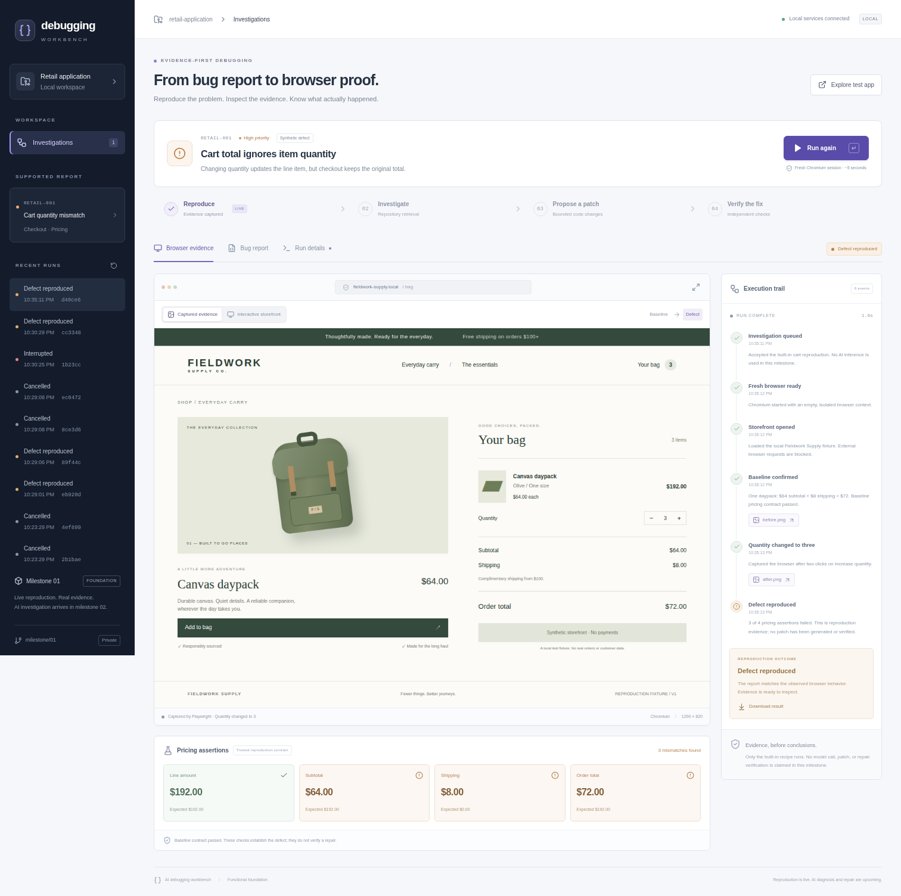

# Milestone 01 — Functional product foundation

Date: 2026-10-15. Status: implemented and verified locally; submitted for owner review. No subsequent milestone has started.

## 1. Executive summary

A working React/FastAPI application reproduces a retail checkout defect in actual Chromium, captures browser evidence, evaluates a separate pricing contract, and persists the investigation in PostgreSQL. A first-time visitor can select the supported report, start reproduction, inspect its execution trail, compare captured states, interact with the real fixture, download artifacts, and reopen prior runs.

The acceptance journey passed against the Docker Compose application. All **24 automated tests** passed: 12 unit tests and 12 browser/API/PostgreSQL integration tests. Ruff, Pyright, TypeScript and production builds passed. A separate API crash check confirmed interrupted-run recovery, retained completed evidence, a successful subsequent reproduction, and clean browser teardown.

## 2. Delivered functionality

| Capability | Delivered state |
| --- | --- |
| FastAPI, async SQLAlchemy, PostgreSQL, Alembic | Working; real database, versioned migration, transactional events and status |
| Retail application | Working synthetic storefront with add-to-bag, quantity controls and shipping rules |
| Browser reproduction | Working live Playwright/Chromium recipe, fresh context, passing baseline, exact defect signature |
| Investigation workspace | Working report view, screenshot comparison, manual storefront, execution trail, pricing assertions, history, raw run data and downloads |
| Evidence | Actual screenshots, console JSON, result JSON, trace ZIP, fixture digest, browser version and elapsed time |
| Operational behavior | Idempotency, two-run admission limit, timeouts, cancellation, terminal-state protection, single-coordinator enforcement and interruption recovery |
| Local delivery | Docker Compose with readiness checks; Python/React development setup; CI workflow and reproducible acceptance scripts |
| AI, retrieval, patching, repair verification | Deferred to milestones 2–3; explicitly identified as upcoming in the interface |
| Recorded or mocked product behavior | None. Failure-path integration tests stub the runner HTTP transport while using real PostgreSQL; the product and browser acceptance tests use actual execution |
| Public hosting / demonstration video | Deferred to milestone 4; no public publication performed |

## 3. Architectural decisions

- A separate credential-free runner accepts a fixed recipe rather than executing commands inside the API. Its internal network, read-only filesystem, unprivileged user and resource limits contain trusted browser reproduction. This is not claimed as an untrusted-code sandbox.
- A single managed API coordinator persists evidence in PostgreSQL, with a database advisory lock preventing a second coordinator. This avoids introducing a distributed queue before the workload requires one.
- Structured NDJSON streams events from runner to API; the UI polls committed state for straightforward refresh and reconnection behavior.
- A passing one-item control precedes the quantity test. Expected amounts are outside the faulty calculation; unknown mismatches are errors rather than false confirmations.
- Future technologies were intentionally kept in their specified milestones. No placeholder retrieval, canned model diagnosis or fake verification was added.

See [architecture](../ARCHITECTURE.md) and [decisions](../DECISIONS.md), including the cancellation correction discovered during self-review.

## 4. Engineering evidence

### Commands and results

| Executed command / check | Actual result |
| --- | --- |
| `gh auth status`, `gh api user`, `gh repo create ai-debugging-workbench --private` | Connected account `kabbersokhi-boop`; private repository created |
| `uv sync --python 3.12`, `npm install`, `playwright install chromium` | Locked Python/Node dependencies and matching browser installed |
| `./scripts/check` | Ruff and formatting passed; Pyright: 0 errors/warnings; 12 unit tests passed in 1.04 s; TypeScript and Vite production build passed |
| `docker compose build`, `docker compose up -d --wait api` | Runtime image built; migration exited 0; PostgreSQL, runner and API healthy |
| `./scripts/e2e` | 12 browser/API/lifecycle integration tests passed in 8.96 s against the Compose API |
| `./scripts/recovery-smoke` | SIGKILL during active reproduction → `interrupted`, no result; completed history unchanged; new run `reproduced`; no runner cleanup traceback |
| Alembic upgrade → downgrade → upgrade in disposable `workbench_migration_check` database | All exited 0; final `alembic_version` was `001`; disposable database removed |
| `GET /api/health` | HTTP 200; `postgresql`, `runner: ready`, `mode: live-browser` |
| Runner environment/resource checks | UID 1001; no `DATABASE_URL` or `NVIDIA_API_KEY` in environment; read-only root; 2 GiB memory; 256 PID limit; capabilities dropped; no new privileges |
| External TCP attempt from runner | Error 101 (`ENETUNREACH`), confirming no external route |
| `npm audit --omit=dev` | 0 vulnerabilities reported; this is not a full security audit |
| `git diff --check` | Passed |

Retained terminal output: [checks](assets/check.txt), [browser/integration tests](assets/e2e.txt), [crash check](assets/recovery.txt). Evidence JSON: [actual completed run](assets/verified-run.json), [actual recovery check](assets/recovery-check.json).

### Observed defect

Example run: `97dcd896-c71d-44fb-b7f7-cd4aacab2245`; Chromium `145.0.7632.6`; runner duration **1,346 ms**. This is one observed run, not a latency benchmark.

| After changing quantity to 3 | Expected | Browser observed | Check |
| --- | --- | --- | --- |
| Line amount | $192.00 | $192.00 | Pass |
| Subtotal | $192.00 | $64.00 | Fail |
| Shipping | $0.00 | $8.00 | Fail |
| Order total | $192.00 | $72.00 | Fail |

The baseline observed one item, $64 subtotal, $8 shipping and $72 total. Its control passed before the defect was attributed. The failed assertions establish reproduction; no repair is claimed.

Fixture SHA-256, confirmed against the checked-out source:

```text
552616ff217f248cdf9b3692c5b3e3b141a80e0ee0b610ff88122484b44a93fe
```

The browser test also checks screenshot loading, manual storefront behavior, report/details navigation, history after reload, a 390 px mobile viewport without horizontal overflow, and absence of page JavaScript errors. API tests verify idempotency, rejected unsupported authority, artifact access, capacity, cancellation and no late success. Lifecycle tests use isolated PostgreSQL schemas for unavailable, empty, malformed and timed-out runner responses, restart recovery and concurrent duplicate requests. Unit tests include correct pricing as a negative control and cancellation-safe cleanup.



Additional captures: [initial workspace](assets/workspace-ready.png), [mobile workspace](assets/workspace-mobile.png), [baseline storefront](assets/retail-before.png), [defect storefront](assets/retail-after.png). These contain only synthetic fixture data. Runtime traces remain outside Git and are downloadable from the application.

## 5. Problems encountered and resolved

- **Disconnect cleanup:** a real API crash exposed Playwright's transport stop future being cancelled repeatedly by ASGI cancellation, producing `InvalidStateError`. Shielded driver startup/teardown corrected it. Regression tests and a repeated real crash check confirmed clean cleanup and successful subsequent execution.
- **Container service discovery:** changing an existing Docker network left the development database without its `db` alias. Recreating that container restored discovery. The final clean Compose definition passed readiness and execution checks.
- **Python tooling setup:** the application package name differs from its import module, requiring explicit Hatch package selection. Pyright also required the project's `.venv` configuration. Both are now explicit and the locked build/check path passes.
- **Mobile inspection:** screenshot review caught a capture taken mid-navigation transition and the trail being hidden at smaller widths. Acceptance captures now request reduced motion; mobile retains the execution trail and offers an expanded evidence viewer.

## 6. Known limitations

**Milestone 1 blockers:** none known after the focused self-review and correction pass.

**Current scope and later work:** one curated defect; local use only; no authentication, arbitrary repository/report ingestion, model inference, RAG, patching or repair verification. The runner executes trusted fixed code and must not accept generated patches. Execution is not resumed after a crash; it is classified interrupted and can be rerun. Artifact retention is manual. Captured browser states are step screenshots, not a continuous video stream. A broader accessibility/security audit, held-out evaluation, deployment and video remain in milestone 4.

## 7. GitHub references

- Repository: https://github.com/kabbersokhi-boop/ai-debugging-workbench (private).
- Branch: `milestone/01-functional-foundation`.
- Final tested implementation commit: [`656427f7df352e3a585a94ba310d4abb0370c6a7`](https://github.com/kabbersokhi-boop/ai-debugging-workbench/commit/656427f7df352e3a585a94ba310d4abb0370c6a7).
- Review PR: https://github.com/kabbersokhi-boop/ai-debugging-workbench/pull/1.
- Report: `docs/reports/MILESTONE-01.md`. This report is committed after the implementation; the PR identifies the final review head including report-only changes.
- Important source: [`api.py`](../../backend/src/workbench/api.py), [`service.py`](../../backend/src/workbench/service.py), [`runner.py`](../../backend/src/workbench/runner.py), [`contracts.py`](../../backend/src/workbench/contracts.py), [`main.tsx`](../../frontend/src/main.tsx), [`retail fixture`](../../fixtures/retail), [`acceptance tests`](../../backend/tests), [`Compose`](../../compose.yaml).

## 8. Next milestone readiness

Ready for milestone 1 review. The supported report identity, separate execution service, durable events, source digest and evidence viewer provide the foundation for commit-aware ingestion and live NVIDIA diagnosis. Milestone 2 still requires secure NVIDIA credentials and actual inference/embedding/reranking endpoint checks. No key was needed or used for milestone 1. Trusted expectations, tests and reports must be excluded from retrieval to prevent leakage. Owner approval is required before beginning milestone 2 or merging this PR.
