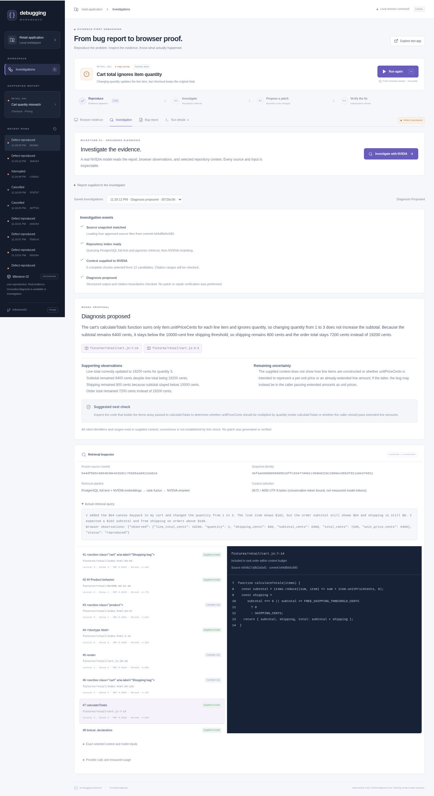

# Milestone 02 — NVIDIA diagnosis and repository retrieval

Date: 2026-10-15. Status: ready for owner review. Scope: grounded diagnosis; no patches or repair verification.

## 1. Executive summary

The existing workbench can reproduce its supported defect, start a real NVIDIA investigation, expose the exact retrieved and supplied source context, propose a structured diagnosis with checked citations, and reopen the saved investigation. Reproduction and diagnosis have separate statuses and histories. The accepted foundation was extended rather than rebuilt.

**Local acceptance: 48 tests passed** — 29 unit tests plus 19 browser/API/PostgreSQL integration tests, including an explicitly enabled live NVIDIA browser journey. The ordinary offline suite skips that one live test. Static checks and the production frontend build passed. A real API crash/restart preserved completed reproduction and diagnosis evidence; active work is classified interrupted.

The evaluation does **not** show an overall RAG accuracy advantage on this four-file target. Lexical retrieval had higher relevant-source recall than dense/hybrid variants. Whole-target context diagnosed the same defect with more input tokens and lower observed latency. One retrieved-context no-answer response was rejected for an invalid citation. These results are retained, not rewritten as successes.

## 2. Delivered functionality

| Capability | Actual state |
| --- | --- |
| Existing browser reproduction, history, downloads, cancellation/recovery | Working; prior run IDs and reviewed artifacts preserved |
| Two requested presentation corrections | Working, with browser regression coverage: interactive footer takes precedence; passed checks and screenshot descriptions no longer assert a defect |
| NVIDIA chat, embeddings and native reranking | Real successful calls; replaceable async adapter, bounded retries, request/token budgets and validated responses |
| Source ingestion | Four allowlisted target source/developer files frozen at an immutable Git commit; source bytes, hashes and chunks persisted |
| Retrieval | PostgreSQL full-text, pgvector exact cosine search, reciprocal rank fusion and native NVIDIA reranking |
| Context selection | Complete chunks within a conservative token bound; actual query, candidates, rank/score data, selection decisions and supplied snippets saved |
| Diagnosis | LangChain prompt/runnable/Pydantic pipeline; report, observations and source context are distinct inputs; checked source references, observations, uncertainty and next check |
| Retrieval Inspector | Working candidate/supplied distinction, frozen snippets, clickable citations, query, snapshot identity, rendered inputs and measured provider usage |
| Failure handling | Missing credentials, provider errors, invalid output/citations, insufficient evidence, cancellation and interruption remain explicit outcomes |
| Evaluation | Frozen eight-query retrieval smoke suite and same-model retrieved/whole-target diagnosis comparison; no held-out repair benchmark |
| Mocked/recorded product fallback | None. Deterministic providers and browser route fixtures exist only in offline tests and are excluded from the runtime image/corpus |

## 3. Decisions and deviations

- Extend the existing single coordinator with a diagnosis task manager. LangChain Core performs real prompt composition, async invocation and structured parsing. No second orchestration engine, LangGraph repair agent, MCP tools or generated execution were prebuilt.
- Use a native NVIDIA VL reranking endpoint with text passages after several older text-reranking routes failed availability checks. No chat-reranking or hardcoded fallback was needed.
- Compile pgvector onto the same PostgreSQL 17 Alpine base to retain the original volume and locale family. Use exact search for 84 chunks; ANN infrastructure is unnecessary at this size.
- Freeze source through an explicit path allowlist and Git commit, then package/persist its bytes. An old reproduction with a different fixture digest cannot be investigated against the new source. Its history and downloads remain available; a new reproduction resolves the mismatch.
- Repeated indexing of the same snapshot/model/chunker is a no-op, including embedding calls. Separate snapshots retain separate identities; accidental cross-snapshot retrieval is rejected.
- Use a UTF-8 byte count as a conservative token bound rather than pretend a generic tokenizer is exact for NVIDIA models. Source headers, line numbering and join separators count toward the 4,000-unit context limit. Provider-reported usage is recorded separately.
- Keep the required hybrid pipeline inspectable while retaining simpler baselines and reporting their better results. This small corpus does not justify a claim of RAG superiority.

See [architecture](../ARCHITECTURE.md) and [decisions](../DECISIONS.md).

## 4. Source and provider evidence

Approved corpus: `fixtures/retail/cart.js`, `index.html`, `styles.css`, `README.md`. Formatting made source readable; the documented contract describes ordinary product behavior. The bug was not fixed. No workbench reports, trusted harness/tests, evaluation labels, reference fixes, secrets or future patches are indexed. No developer tests are included in this corpus.

- Source commit: `b44dfbb5c6804638e42d2dcc76565aa8d12aeb2a`.
- Snapshot: `3efaee90d8658d95519ffc03477d481c39de8228c2999ec6bb3fd11a6e370d11`.
- Four files; **13,983 UTF-8 bytes; 84 source-aware chunks**. JavaScript uses Tree-sitter boundaries; other files use headings/sections/rules and bounded line splits.
- Matching reproduction fixture digest: `2b5d7673fa2c2f90c173f6b9c2a2c2112d05a12cb4fd6501ab3c70bcaeaa9564`.
- PostgreSQL reported installed pgvector version **0.8.7**; the stored NVIDIA embedding dimension is **2,048**.

### Successful provider configuration

| Workload | Tested model | Endpoint | Outcome |
| --- | --- | --- | --- |
| Chat | `nvidia/nemotron-3.5-super-vl-120b-a12b` | `https://integrate.api.nvidia.com/v1/chat/completions` | HTTP 200; structured, source-cited diagnosis |
| Embedding | `nvidia/nemotron-3-embed-1b` | `https://integrate.api.nvidia.com/v1/embeddings` | HTTP 200; passage/query modes; 2,048 dimensions |
| Native reranking | `nvidia/llama-nemotron-rerank-vl-1b-v2` | `https://ai.api.nvidia.com/v1/retrieval/nvidia/llama-nemotron-rerank-vl-1b-v2/reranking` | HTTP 200; complete passage ranking and logits |

Actual unsuccessful probes are retained in [endpoint evidence](assets/milestone-02/endpoint-probes.json): E5 embeddings returned 410; `llama-3.2-nv-embedqa-1b-v1` returned 404; the older Mistral reranking route returned 404; the NV 1B, 500M and Llama-Nemotron text-only reranking routes returned 410. A Mistral chat model returned 404, and DeepSeek Flash timed out under a bounded probe. Catalog listing was not treated as proof of inference availability.

A small representative comparison held the report, observations and supplied chunks constant:

| Model, thinking disabled | Structured output/citations | Manual cause assessment | Observed latency | Prompt / completion tokens |
| --- | --- | --- | --- | --- |
| Nemotron 3.5 Lightning 30B | Accepted | Confused line-item count with the missing quantity factor | 9,375 ms | 2,473 / 449 |
| Nemotron 3.5 Super VL 120B | Accepted | Precisely identified omitted quantity in the subtotal reduction | 1,599 ms | 2,473 / 351 |

The Super model was selected for this workload. These are individual observations, not a general model ranking. An earlier Lightning probe with thinking enabled exhausted its 600-token output allowance without content; empty/truncated output was not accepted. [Comparison responses](assets/milestone-02/chat-comparison.json) are retained. Application defaults disable thinking, use temperature 0 and cap output at 1,400 tokens.

### Real application acceptance run

Reproduction `6b506cc9-d8b1-41ab-b1a0-3bde30c90469` → investigation `3072bc06-7576-4f9c-bc8a-6aec82e92ed2`.

The model identified `calculateTotals` summing per-unit prices without quantity, grounded its proposed diagnosis in supplied `cart.js` ranges, noted missing caller context, and suggested a next check. All cited source identifiers/ranges existed in its actual supplied context. This validates citation boundaries, not the reasoning or a repair.

The run supplied **5 of 12 candidates**, **3,972 context bytes** within the 4,000-unit bound. Query embedding, native reranking and chat all returned HTTP 200. Chat reported 2,537 prompt and 379 completion tokens. The saved diagnosis was retrieved unchanged after an actual API process restart. [Sanitized full live run](assets/milestone-02/live-investigation.json) includes reproduction, query, candidates, supplied context, rendered prompt, raw accepted response, structured result, citations, events and provider calls; it contains no credentials or authorization headers.

[Mobile capture](assets/milestone-02/live-investigation-mobile.png).

## 5. Retrieval and diagnosis comparisons

The [frozen suite](../../evals/retrieval-smoke.json) has **8 queries: 6 with relevant-source labels and 2 no-answer cases**. Two questions paraphrase the **same single cart defect**; the remaining answerable questions cover supporting target behavior. Every condition used the same frozen corpus and warm stored index. Latency below is the mean over eight single retrieval observations, including provider requests where applicable.

| Retrieval | Mean recall@5 | Mean precision@5 | MRR | Selected-context recall | Mean latency |
| --- | --- | --- | --- | --- | --- |
| Lexical | 1.000 | 0.433 | 0.694 | 0.833 | 10.6 ms |
| Dense | 0.667 | 0.300 | 0.756 | 0.667 | 375.3 ms |
| Hybrid RRF | 0.833 | 0.367 | 0.833 | 0.750 | 371.1 ms |
| Hybrid + native reranking | 0.833 | 0.367 | 0.889 | 0.750 | 664.0 ms |

Reranking improved first-relevant ordering relative to unreranked hybrid retrieval, but did not improve recall and did not beat lexical recall. The live inspector also shows a retrieved caller chunk excluded by the complete-chunk budget. No-answer queries can still return candidates; there is no calibrated retrieval abstention threshold.

Diagnosis comparison: same selected Super model, temperature 0, thinking disabled, 1,400 output tokens; one observation per condition. Whole-target input includes all four source files. RAG latency includes retrieval; whole-target latency does not need retrieval.

| Task / context | Context bytes | Chat prompt / completion tokens | End-to-end latency | Accepted outcome |
| --- | --- | --- | --- | --- |
| Supported defect / retrieved | 3,989 | 2,542 / 328 | 1,875 ms | Diagnosis |
| Supported defect / whole target | 17,116 | 7,954 / 338 | 1,471 ms | Diagnosis |
| No payment-backend answer / retrieved | 3,971 | 2,660 / 519 | 5,950 ms | **Rejected: invalid citation** |
| No payment-backend answer / whole target | 17,116 | 7,903 / 415 | 1,746 ms | Insufficient evidence |

Three conditions returned accepted structured results with valid citation boundaries; one failed the source/range check and remained rejected. Citation validity is not a correctness score. Both supported-defect outputs identified the relevant cause on manual inspection; neither attempted a repair. The corpus is too small and the defect count too low to claim general debugging accuracy or a resolution rate.

The final retained experiment reported **39,273 tokens across provider requests**, including embedding/reranking workloads. This excludes initial indexing, exploratory probes and an earlier aborted evaluation; it is not a total billing figure. Provider dollar pricing/billing could not be verified, so **cost is unavailable**, not estimated as zero. [Readable evaluation summary](assets/milestone-02/evaluation-summary.json) and [full measured inputs/results](assets/milestone-02/evaluation.json) retain actual usage and failures.

## 6. Verification commands and results

| Executed command / check | Result |
| --- | --- |
| `./scripts/check` | Ruff/format passed; Pyright 0 errors; 29 unit tests passed in 1.13 s; TypeScript/Vite build passed |
| `LIVE_NVIDIA_E2E=1 ./scripts/e2e` | 19 passed in 20.47 s; actual browser reproduction, live NVIDIA diagnosis, citations, inspector, reload, mobile layout and all PostgreSQL/offline lifecycle cases |
| `uv run pytest -m integration -k investigation_cancel` from `backend/` | Passed; cancel while model work is active, retain partial retrieval, keep reproduction independent, recover interrupted diagnosis |
| `./scripts/recovery-smoke` | API SIGKILL → interrupted reproduction; completed history unchanged; fresh run reproduced; no runner cleanup error |
| Saved investigation GET after that restart | Identical to captured completed investigation; no provider call needed to reopen |
| `docker compose build migrate`; `docker compose up -d --wait api` | Image built; migration successful; database, runner and API healthy |
| `uv run --project backend python scripts/evaluate.py --live --run-id 58620e0a-bf86-4a10-85bc-0fc25407a38e` | Completed frozen 32 retrieval conditions and 4 diagnosis conditions, preserving the invalid-citation outcome |
| Disposable database: upgrade 001 → insert sentinel → upgrade head → downgrade 001 → upgrade head | Final revision 003 and vector 0.8.7; original sentinel run survived; production volume untouched |
| Pre-change backup + preservation checks | All 16 original run IDs retained; reviewed before/after screenshot hashes unchanged |
| Runner/API credential checks | Key present only in API environment; absent from runner environment/runtime settings; no backend `.env` in either image |
| Staged-file credential-prefix scan; `git diff --check` | Passed; secret file ignored and unstaged |

Logs: [checks](assets/milestone-02/check.txt), [full live acceptance](assets/milestone-02/e2e-live.txt), [recovery](assets/milestone-02/recovery.txt), [preservation](assets/milestone-02/preservation.json). CI runs offline checks plus real PostgreSQL/browser reproduction and explicitly skips live NVIDIA without opt-in/credentials; see the PR checks for its remote result.

## 7. Problems resolved and limitations

- Retired/unavailable provider routes were detected through actual calls. Current successful models/endpoints were selected explicitly; no canned diagnosis or silent fallback was introduced.
- Runtime settings originally could read a backend secret file in a local runner process. Provider-only secret loading and explicit image copies now keep that file out of the runner and images.
- An initial evaluation stopped at a citation rejection before saving all measurements. The evaluator now retains rejected conditions and writes intermediate measurement files. It does not retry invalid outputs until they pass.
- CI caught a polling-only cancellation test; the final test waits for an explicit event emitted after model-call entry. Static checks and the active-cancellation test passed after the correction.
- Self-review corrected context accounting to include join separators and aligned saved message roles with the provider's actual roles. Offline replay confirmed unchanged selected source IDs across all 32 frozen retrieval conditions. [Replay evidence](assets/milestone-02/selection-review.json).

**Blocking limitations:** none known for the stated local, approved-snapshot diagnosis scope.

**Nonblocking limits:** one curated defect; weak evidence for any RAG benefit; one invalid no-answer citation; no calibrated abstention threshold; no general accuracy claim. The rejected evaluation response's exact raw citation was not retained, though its input, usage and rejection classification are retained. Index reuse is scoped to snapshot/model/chunker identity; newly approved snapshots need a new index. Token bounds are conservative byte-based bounds, not exact model tokenization. Provider availability may change. Local use has no authentication or durable task resumption, and artifact retention is manual. Generated patches, repair verification, public hosting and the broader held-out benchmark remain later milestones.

## 8. GitHub references and next milestone readiness

- Repository: https://github.com/kabbersokhi-boop/ai-debugging-workbench (private).
- Branch: `milestone/02-grounded-diagnosis`.
- Tested implementation: [`a94d05e186714fc1f2e606e1b94a8e19acdb8efb`](https://github.com/kabbersokhi-boop/ai-debugging-workbench/commit/a94d05e186714fc1f2e606e1b94a8e19acdb8efb).
- Review PR: https://github.com/kabbersokhi-boop/ai-debugging-workbench/pull/2, stacked against `milestone/01-functional-foundation`; PR #1 remains unmerged at reviewed head `8c9e57f33ef67413fd3c11b2a9af0dde862c5e05`.
- Report: `docs/reports/MILESTONE-02.md`. A subsequent report-only commit is included in the final PR head.
- Important code: [provider](../../backend/src/workbench/rag/provider.py), [snapshot/chunking](../../backend/src/workbench/rag/snapshot.py), [retrieval](../../backend/src/workbench/rag/retrieval.py), [diagnosis](../../backend/src/workbench/rag/diagnosis.py), [lifecycle](../../backend/src/workbench/rag/service.py), [inspector](../../frontend/src/Investigation.tsx), [frozen evaluation](../../evals/retrieval-smoke.json).

Ready for Milestone 2 review. Source identities, persisted retrieval/diagnosis records, provider boundaries and explicit failure states can support later repair work. **Milestone 3 has not started.** Neither review PR is merged, and the repository remains private.
