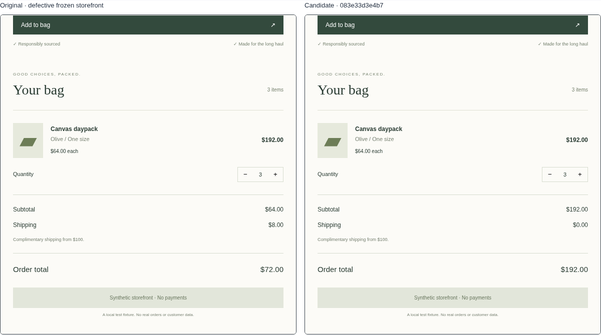
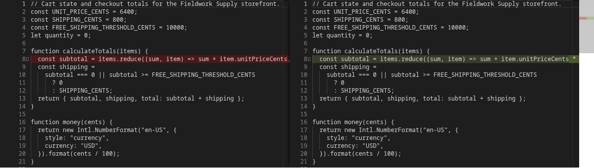

# Milestone 03 — model-generated candidates and independent verification

Date: 2026-10-16 (Asia/Kolkata). Scope: one approved retail defect; local candidate repair and named trusted checks. Ready for owner review; final implementation checks passed. Report-head checks are linked below.

## 1. Executive summary

The existing workbench now completes reproduction → NVIDIA diagnosis → missing source read through MCP → model-produced patch → isolated candidate → independent browser verification → interactive comparison and saved history. The original defective storefront, frozen source and earlier evidence remain unchanged.

A fresh live NVIDIA browser journey passed, including the exact diff, **12 trusted checks**, original `$72.00` versus candidate `$192.00` at quantity three, candidate reset, patch download and reopening. This is evidence for the supported checks on one curated defect, **not** a general repair success rate or proof of correctness for all inputs.

Local checks: **50 unit tests**, **34 offline integration/browser tests**, and **one separately enabled live repair browser test** passed. The ordinary suite explicitly skips two live-provider opt-ins. Focused follow-up coverage checks preview loading and rejects a delayed response after selecting another repair.

## 2. Delivered functionality

| Capability | Actual state |
| --- | --- |
| Existing reproduction, diagnosis, Retrieval Inspector, citations, history and downloads | Working; separate statuses retained |
| Typed LangGraph repair | Working; native PostgreSQL intermediate checkpoints and pending writes, not just a final response |
| MCP | Real official-SDK stdio discovery/calls; frozen source search/read, bounded candidate application, fixed verification |
| Runtime NVIDIA patch generation | Working; exact model proposal retained; deterministic exact-text application with no manual patch correction |
| Candidate environment | Separate internal network, read-only application volume/root, bounded CPU/memory/PIDs/tmp, no secrets or Docker socket |
| Independent verification | Trusted external Playwright control; visible text, controls, bounds and baseline behavior; results bound to actual bytes, candidate, verifier and image |
| Product experience | Local Monaco diff/worker, attempt history, named original/candidate checks, isolated preview, reset, downloads and reopen |
| Cancellation, budgets and recovery | Working; partial evidence retained; unsafe restart resumption classified interrupted after reconciliation |
| Mocked/recorded runtime fallback | None. Offline providers/negative patches exist only in tests and are excluded from runtime/candidate images |
| Deferred | Arbitrary repositories/shell tools, dependency installation, publication/merge agent, hosted sandbox, broader held-out benchmark |

## 3. Decisions and carry-forward corrections

One LangGraph coordinates six explicit nodes: load, decide, inspect, apply, verify, finalize. A Pydantic tool-decision loop is sufficient; native model tool calling was not assumed. Real MCP calls cross a subprocess transport, with run/snapshot/broker context supplied by trusted code. The child receives no NVIDIA/database environment. Model arguments cannot select commands, run identities, host roots, permissions or verifier suites.

Only `fixtures/retail/cart.js` can change. The patch names the immutable snapshot and original file SHA; unique old-text matches, size/scope checks, canonical proposal hash and candidate hash prevent stale or ambiguous application. A trusted Docker broker provides the execution boundary without changing the reproduction runner or giving the agent/API a Docker socket. Native checkpoint tables are managed by additive Alembic revision 004.

The run shares **8 provider requests including retries**, **6 model decisions**, **2 proposed patches**, **2,000 output tokens per request**, **16,000 reserved output tokens**, and a **300-second admission deadline**. Maximum requested output is reserved even on failed attempts/retries. Source tools allow at most six calls and 80 lines per read. Nothing replenishes these budgets at another graph node.

The three accepted-review corrections are included:

1. **Rejected output retention:** bounded, sanitized text is saved before diagnosis/repair schema and citation validation. Rejection reasons remain alongside it; rejected output never becomes an accepted result. Truncated provider text is retained, and a malformed later response cannot inherit an earlier response's text. Regression coverage: `test_rejected_output_is_retained_before_schema_validation`, `test_rejected_citations_retain_bounded_sanitized_model_text`, `test_truncated_chat_retains_actual_text_without_reusing_a_previous_response`, and persisted invalid-investigation/repair cases.
2. **Evaluation output initialization:** directories are created before provider calls; completed retrieval/diagnosis measurements are saved incrementally using atomic file replacement. `test_evaluation_initializes_nonexistent_directory_and_saves_incrementally` uses an absent directory and an offline provider. Expensive live retrieval comparisons were not rerun. Older missing rejection text was not invented or written into historical evidence.
3. **Saved report versus draft:** selected investigation reports render as immutable inputs. Editable text is labeled a draft for the next investigation. `test_saved_investigation_reports_are_immutable_and_separate_from_draft` switches between two different saved reports while preserving a third draft.

See [architecture and isolation](../ARCHITECTURE.md#bounded-repair-milestone-3) and [decisions](../DECISIONS.md).

## 4. Live execution and verification evidence

### Exact identities

- Reproduction: `4d9e116d-24f8-43c1-9857-8bedc69c13b5`.
- Diagnosis: `c3a566ba-6ecf-4cc7-9101-2a99da35b148`.
- Repair: `eb3cd0d8-273d-40f9-b639-50feb1bbd9f3`; one candidate attempt.
- Frozen source commit: `b44dfbb5c6804638e42d2dcc76565aa8d12aeb2a`.
- Snapshot: `3efaee90d8658d95519ffc03477d481c39de8228c2999ec6bb3fd11a6e370d11`.
- Original cart.js SHA-256: `b3ba2ed2012cb709546ce221798cdc686754350ba9f1ef4d0cda9fc3c0a995e6`.
- Candidate: `083e33d3e4b7f600a8c7625ae3c1fc608c4cf2ed554c0b8fda7690d5c5f150bb`.
- Canonical proposal hash: `0677fd629760e23431295932da8188b9b63072ca40944efcb1e553d7ebb697a0`.
- Candidate cart.js SHA-256: `97f7f3dc51b1c506bc9c8cddefcfa060b1d769d61074e5db6227306d7ef605ae`.
- Verifier: `01a1bc15166fff02c0c5bed1dc82c64e0fb3c551a916c64c64e88d665d2c6a6c`.
- Candidate image: `sha256:edaa4ae5534a7d6ed8ec84fc3808b90fbb305fab28763022650c06f83b94251a`.

The model first requested cart.js lines **1–65** through `read_source`, obtaining the caller previously missing from diagnosis context. It then proposed a single subtotal edit multiplying unit price by `(item.quantity || 1)`. That exact edit was applied unchanged. This expression was generated at runtime, not supplied as a reference patch. The candidate's JavaScript/HTML/CSS bytes were inspected before and after verification.

The official MCP handshake negotiated protocol `2025-11-25` with SDK/server `1.30.0`. Recorded discovery lists the actual four tools. The live sequence is `read_source` → `apply_candidate` → `verify_candidate`, all successful. The fixed verification request invokes the external trusted procedure `retail-pricing-browser-v1`; it does not execute an agent-selected command or generated test.

The same expectations fail the original application and pass all 12 candidate checks: empty bag, add-one baseline, increments to two/three, decrement to two, lower/upper limits, decrement to eight, zero/large input clamping, invalid input, and repeated-add limit. Visible money, unit price, counts and control states are checked independently of `data-cents`. Deterministic negative fixtures include a quantity-three-only calculation, an unchanged defective calculation, correct arithmetic that hides the visible total, and an oversized rendered total. All are rejected; they are **offline fixtures**, not live experiments.

[Named check comparison](assets/milestone-03/live-repair-checks.png), [full workspace](assets/milestone-03/live-repair.png), [mobile workspace](assets/milestone-03/live-repair-mobile.png).

### Provider calls and measured usage

The existing successfully tested defaults were reused; no new model benchmark was conducted.

| Workload | Actual NVIDIA model / endpoint | Final run outcome |
| --- | --- | --- |
| Diagnosis + repair chat | `nvidia/nemotron-3.5-super-vl-120b-a12b` · `integrate.api.nvidia.com/v1/chat/completions` | Three HTTP 200 chat calls across diagnosis and repair |
| Diagnosis query embedding | `nvidia/nemotron-3-embed-1b` · `integrate.api.nvidia.com/v1/embeddings` | HTTP 200; existing immutable index reused |
| Diagnosis native reranking | `nvidia/llama-nemotron-rerank-vl-1b-v2` · NVIDIA retrieval reranking endpoint | HTTP 200 |

The two repair calls reported **7,608 prompt + 410 completion = 8,018 tokens**, with observed latencies **646 ms** and **1,242 ms**. Diagnosis reported 149 embedding tokens, 3,131 reranking tokens and 2,887 chat tokens. These are provider-reported workloads, not a normalized billing figure. Repair admission through terminal persistence took about **20.5 seconds** in this observation; the complete live browser test took **33.78 seconds**. Two of eight repair requests were used and 12,000 reserved output tokens remained. **Dollar cost is unavailable**; no dollar estimate or general latency claim is made.

[Full sanitized final live record](assets/milestone-03/live-repair-eb3cd0d8-273d-40f9-b639-50feb1bbd9f3.json) retains model inputs/raw proposals, source reads, MCP discovery/arguments/results, exact diff, attempts, checks, usage and identities. It contains no authorization headers or credentials.

### Earlier attempt and commit coverage

An earlier development run, `1d3a5f3e-09da-44b0-a4ab-781bbb364658`, also generated a candidate and passed its then-current verifier. Its browser journey failed because starting the candidate reset the original session after interaction began. [That full record](assets/milestone-03/live-repair-1d3a5f3e-09da-44b0-a4ab-781bbb364658.json) and [failed browser log](assets/milestone-03/first-live-browser-test.txt) are retained. It predates the implementation commit and uses verifier `dfed51082dcdf738aafdbfe610eb8caf750bd044203996455963f5d85d06aba4`; it does **not** prove the final revision.

A second development live record, [`fe3e2aa3-ab69-43ff-876a-12605dd98440`](assets/milestone-03/live-repair-fe3e2aa3-ab69-43ff-876a-12605dd98440.json), covers core implementation `ff2fe46b4061c8315bd7871a8c9516085752673d` and passed its complete browser journey. Follow-up `ad77d47297175f3a4288f544b5973d85b26151b1` fixed preview loading/selection protection and management-address health probing. The final verifier follow-up bounds retained observations/errors and rejects oversized output.

The **final fresh live record and final offline suite cover `c6f8739b84509eeb84df836fd5a480fea7977889`**, including those corrections. Its screenshots and independent checks use the final verifier version listed above. [All three real model-generated records](assets/milestone-03/evidence-ledger.json) remain available; the final report/evidence commit changes no runtime code. Reopening/capturing saved evidence requires no additional inference. These are three observations of the same defect, not a success-rate benchmark. No live model patch failure was observed; the earlier browser failure and all offline negative outcomes are represented separately.

## 5. Verification commands and results

| Actual command / check | Result |
| --- | --- |
| `./scripts/check` | Ruff/format passed; Pyright 0 errors; 50 unit tests passed in 2.37 s; TypeScript/Vite production build passed |
| `./scripts/e2e` | 34 passed in 146.05 s; 2 explicit live opt-in skips; real PostgreSQL, MCP, Docker candidates and browser interactions |
| `LIVE_NVIDIA_REPAIR=1 ./scripts/e2e -k live_nvidia_repair` | 1 passed in 33.78 s; real NVIDIA diagnosis/repair and complete browser journey |
| `./scripts/recovery-smoke` | Actual API SIGKILL/restart; unfinished reproduction interrupted; completed history unchanged; new reproduction succeeded |
| Saved final repair GET after that crash, followed by browser reopen/capture | Byte-equivalent JSON evidence; working diff/download/preview; no inference call |
| PostgreSQL integration restart scenario with a real live candidate | Reconciled actual hash/environment; cleanup; interrupted status; no verification success inferred |
| Disposable DB restored from M2 backup: `alembic upgrade head`, `downgrade 003`, `upgrade head` | Revisions 004 → 003 → 004; all 30 prior runs retained; production volume untouched |
| Pre-M3 backup comparison | All prior 30 runs, 131 events, 2 investigations, 1 snapshot, 1 index and 84 chunks unchanged; reviewed M1 screenshot bytes unchanged |
| Image/environment audit | Runtime Python/source bytes match implementation; only API has NVIDIA/DB environment; only broker has Docker socket; no backend `.env` in images |
| Staged credential scan, `git diff --check`, original fixture/snapshot diff | Passed; no canonical fixture or historical snapshot changes |

Logs: [checks](assets/milestone-03/check.txt), [offline acceptance](assets/milestone-03/e2e.txt), [live acceptance](assets/milestone-03/live-browser.txt), [recovery](assets/milestone-03/recovery.txt). Audit evidence: [preservation](assets/milestone-03/preservation.json), [migration](assets/milestone-03/migration.json), [implementation/image binding](assets/milestone-03/implementation-evidence.json), [restart/reopen capture](assets/milestone-03/reopen-and-capture.json).

Tests cover actual MCP discovery/permission failures, stale/scope/malformed patches, isolation/network/filesystem restrictions, external verifier integrity, candidate/hash binding, invalid model output, failed/revised attempts, shared retries/output/timeouts, cancellation, persisted checkpoints/history, interruption, saved report selection and browser interactions. CI runs the same offline checks on the stacked PR; both final implementation checks passed; the report-head remote result is authoritative in [PR #3 checks](https://github.com/kabbersokhi-boop/ai-debugging-workbench/pull/3/checks).

## 6. Problems resolved and actual isolation limits

Chromium's crash handler initially needed a writable configuration location; it now uses bounded temporary storage. A private-only Docker network did not publish the preview listener, so preview delivery has a separate network/listener while control stays bound to its private management address. Cold CI exposed a hostname-based health probe selecting the wrong interface; it now resolves the same explicit management alias as the control listener.

Preview startup is asynchronous. Candidate reset now preserves the original session, loading has explicit feedback, and selecting another repair/attempt invalidates any outstanding preview response. A regression delays a response until after selection changes and confirms it cannot display under the new identity. Self-review also bounded captured DOM/error text and added a real oversized-output negative candidate; truncation cannot produce a verification pass. The test allows bounded container startup time instead of assuming five seconds.

Only the trusted broker has Docker/host authority. Candidate containers have read-only source/root, a private internal network, 1 CPU, 1 GiB memory, 192 PIDs, bounded tmp/shared memory, no secrets/socket/verifier files, bounded retained fields/errors, and a 55-second trusted verification budget. Oversized observations fail rather than being accepted after truncation. Actual isolation/cleanup probes passed. Trusted expectations and Playwright control run outside the candidate container. Candidate code cannot select the verifier or modify its files.

**Blocking limitations:** none known for the approved local snapshot/defect scope.

**Nonblocking limitations:** Chromium's internal OS sandbox is disabled inside the constrained container; browser/OS/Docker exploits are not covered. The visitor's interactive iframe has opaque-origin/CSP restrictions but not Docker CPU/memory limits on the browser tab. This is not a complete hostile-code sandbox or production deployment. There is no authentication or safe automatic repair resumption; interrupted runs require a new repair. Only one file/defect and finite named checks are supported. Monaco is lazy-loaded locally but its editor chunk is relatively large. Artifact retention remains manual. No general repair accuracy, RAG improvement, universal correctness or dollar-cost claim is made.

## 7. GitHub references and next milestone readiness

- Private repository: https://github.com/kabbersokhi-boop/ai-debugging-workbench.
- Branch: `milestone/03-verified-repair`.
- Tested final implementation: [`c6f8739b84509eeb84df836fd5a480fea7977889`](https://github.com/kabbersokhi-boop/ai-debugging-workbench/commit/c6f8739b84509eeb84df836fd5a480fea7977889).
- Earlier core/UI commits: `ff2fe46b4061c8315bd7871a8c9516085752673d`, `ad77d47297175f3a4288f544b5973d85b26151b1`; their evidence coverage is separated above.
- Final review head: [`review/milestone-03`](https://github.com/kabbersokhi-boop/ai-debugging-workbench/tree/review/milestone-03), a review tag pointing to the final report/evidence commit. Its exact SHA is also recorded in the PR delivery summary.
- Review PR: https://github.com/kabbersokhi-boop/ai-debugging-workbench/pull/3, stacked against `milestone/02-grounded-diagnosis` at accepted head `d0b88c11034aa7a54d8317d8d236767631995b50`.
- Report: `docs/reports/MILESTONE-03.md`.
- Important code: [graph](../../backend/src/workbench/repair/graph.py), [coordinator](../../backend/src/workbench/repair/service.py), [MCP server](../../backend/src/workbench/repair/mcp_server.py), [MCP client](../../backend/src/workbench/repair/mcp_client.py), [patch validation](../../backend/src/workbench/repair/contracts.py), [broker](../../backend/src/workbench/repair/broker.py), [trusted verifier](../../backend/src/workbench/repair/verifier.py), [repair workspace](../../frontend/src/Repair.tsx).

Ready for owner review. Prior PRs remain unmerged, no generated application change has been published, and the repository remains private. **Milestone 4 has not started.**
