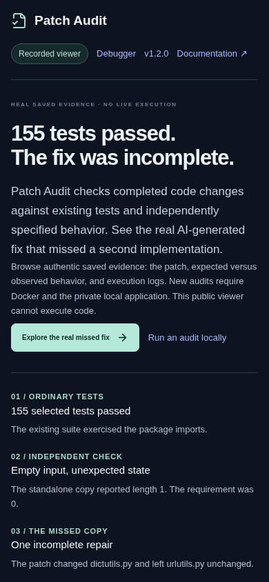

# Patch Audit public presentation review

**Review branch:** `docs/patch-audit-public-presentation`  
**Base:** accepted `v1.2.0` / `a00bbc3399d7dde96a930c7da8db2e82f99295d6`  
**Scope:** documentation, a recorded-viewer first-screen link, screenshots and a current recorded walkthrough. No runtime evaluator, execution policy, historical evidence, deployment or release changes.

## Plan

- **Communication problems:** the product purpose and genuine Boltons result were already present, but dense detail competed with the first-time path; there was no current v1.2.0 flagship demo; the viewer's generic “saved audit” action did not explain which result to inspect or where a new local audit begins.
- **Audience:** recruiters and hiring managers first, then AI/tooling engineers and technical reviewers.
- **Narrative:** one carefully bounded real example → why ordinary and independent results differ → what the product records → public playback versus locally approved execution → architecture and study limitations.
- **Surfaces:** README, recorded-mode intro copy, a case-study document, a current walkthrough with poster/captions/transcript, and this review report with before/after screenshots.
- **Highest-impact changes:** directly open the missed-fix record, show the test/independent contrast immediately, and point separately to local setup. Keep complete protocol and architecture linked rather than repeating it all on the landing page.
- **Out of scope:** evaluator/checker changes, new campaign or model calls, new runtime capability, deployment, merge, release, repository rename, and unverified first-person ownership claims.
- **Success criteria:** first screen states the product and leads to authentic evidence; local and public routes are distinct; the real study denominator and limitations remain accurate; the recorded build exposes no import or execution authority; desktop/mobile UI is legible.

## Previous presentation findings

The accepted README already gave a technically sound definition, accurate study accounting, boundaries and screenshots. This review did not find missing technical substance. The weakness was prioritization: the reader moved through multiple dense explanations before the “Run locally” section, while the most memorable result was not paired with a current product walkthrough. The recorded page had a good generic headline and stated that it was read-only, but its generic action did not name the missed-fix example and the first screen did not link to the local quickstart.

The original repository name also describes its earlier debugger workflow. The README now states the hierarchy plainly: `ai-debugging-workbench` is the repository; Patch Audit is the current product. The name was not changed.

## External references and design decisions

- [Ruff README](https://github.com/astral-sh/ruff): a short, concrete product definition followed by a direct getting-started path and deeper topic links. Applied: ordinary-language definition and clear next actions before technical detail.
- [pytest README](https://github.com/pytest-dev/pytest): demonstrates the tool with a small actual input and output before enumerating features. Applied: lead with one real patch and its observed outcomes, with authentic evidence rather than a broad product claim.
- [OpenSSF Scorecard](https://openssf.org/projects/scorecard/): frames the purpose in a direct sentence and makes use paths discoverable. Applied: make the public evidence viewer and local workflow visibly different.

These are presentation patterns, not claims that the projects or their users endorse Patch Audit. No competitor text, branding or assets were copied.

## README and case study

The revised [README](../../README.md) starts with a direct definition, the 155-test hook, links to the specific saved Boltons record, a 73-second walkthrough and the local quickstart. It then presents the case, a workflow diagram, two explicit try-it paths, engineering decisions, limitations and links to deeper documentation. Long parameter tables and experimental details are no longer duplicated in the landing page; existing technical reports remain linked.

The new [case study](../PATCH-AUDIT-CASE-STUDY.md) separates the authentic Boltons development run from G3. It says 155 selected tests passed; the independent empty-input check found a length-one observation instead of zero; the keys/items observations are part of one incomplete repair. Separately, G3 covered six genuine historical developer patches: five ordinary passes, one regression caught ordinarily, and zero additional independent findings. It does not pool the studies or claim general detection performance.

The case study distinguishes what retained artifacts establish from what they cannot establish about personal ownership or unaided work. This presentation review and its edits are explicitly identified as Codex-assisted. Owner-confirmed motivations, contributions or learning remain unasserted.

## Recorded website and demo

`AuditIntro` now labels the primary recorded action **“Explore the real missed fix”** and adds **“Run an audit locally”** to the quickstart. The query-string entry point selects the retained Boltons record. This is a small first-screen change; the technical evidence screens and selector behavior remain intact.

The new [73-second walkthrough](../demo/patch-audit/patch-audit-current.mp4) records the actual v1.2.0 recorded-release application built from this review branch. It shows the saved Boltons outcome, separate ordinary and independent status cards, the omitted implementation explanation, saved evidence controls, and a return to the local-workflow link. No fake result or interaction was inserted; no code was run. It is silent, compressed H.264 video with [WebVTT captions](../demo/patch-audit/patch-audit-current.vtt), a [text transcript](../demo/patch-audit/patch-audit-current-transcript.md), and an actual-screen [poster](../demo/patch-audit/patch-audit-current-poster.png). The previous `v1.1.0` debugger walkthrough remains historical and is not linked as the Patch Audit flagship.

The production URL remains unchanged pending independent review. Its current deployed intro will not show these copy changes until a later separately authorized deployment. The public URL already serves saved Patch Audit evidence; its new-entry URL was checked with the record query parameter.

## Before and after

| Before: accepted recorded intro | After: review-branch recorded intro |
| --- | --- |
|  |  |

The new walkthrough itself is an actual moving before-to-detail walkthrough. The mobile capture below is full page and shows the same first-screen actions at a 390px viewport.

## Validation results

- `npm run build --prefix frontend`: **passed** (`tsc -b` and Vite production build). Vite reports the existing large lazy diff-editor chunk warning; no build failure.
- `git diff --check`: **passed**.
- Local markdown link check across README, case study and transcript: **no broken relative paths**.
- `ffmpeg` decode of the MP4: **passed**. `ffprobe`: 1440×900, 25 fps, 73.04 seconds, approximately 1.6 MB. The VTT duration matches the film within the final cue.
- Real browser playback against the built local recorded-release container: HTTP 200; retained missed-copy record selected; saved status was failed, ordinary outcome passed and independent outcome failed; no page errors; no non-GET API requests. The real MP4 was captured from this flow.
- Mobile browser at 390×844: **390px document width / 390px viewport**, no horizontal overflow, no page errors or mutation requests; saved evidence and the missed-implementation explanation loaded.
- Recorded container health: `mode=recorded`, `live_execution_slots=0`, `provider_token_budget=0`. `/api/patch-audits/tasks`, `/api/repository-audits/sources` and `/api/runs` returned GET 404 / POST 405. Recorded evidence GET was available and POST returned 405.
- Preview used only the restricted `compose.release.yaml` image on loopback port 18020. No privileged local API, inference or campaign was started. No production deployment occurred.

These checks are bounded to the changed UI and recorded service. They are not fresh campaign outcomes or proof of human comprehension; no independent human testers were available.

## Historical evidence and execution boundary

This branch changes no files under `evaluation/`, `recordings/`, frozen campaign inputs, G1–G4 reports, verifier identities, release tags or original execution artifacts. The featured record is loaded from its retained recording. Replaying it caused no execution or mutation request. Public execution remains disabled in the actual restricted container; fresh patch audits are available only in the separate local-owner application.

## Remaining limitations

- The current walkthrough is silent; captions and transcript carry the narration. The prior old-version film is not a substitute for this current walkthrough.
- The production URL will remain on its current deployed copy until a separately reviewed and authorized deployment.
- Docker setup and trustworthy requirement authoring remain substantial for a first-time local user.
- The example is a real, useful case, but one miss and a six-candidate retrospective campaign cannot support a general detection-rate claim. G3 found no added findings.
- The public repository lacks a project license; no licensing claim is made here.

## Recruiter-facing assessment

**Before: 6/10 for first-impression clarity.** The accepted product and technical evidence were credible, but a new reader had to work through dense explanation to find the strongest concrete example and understand the demo boundary.

**After: 8/10 for first-impression clarity (author assessment, not user research).** The first screen answers what the product is, puts the authentic missed fix and current demonstration in reach, and distinguishes playback from local execution. Within roughly a minute a reader can identify the ordinary pass, independent finding, local entry point and public limitation. A senior reviewer still needs the linked reports to assess the protocol; the product has not shown broad effectiveness, and G3's zero additional findings should temper any claim of added value.

**Engineering quality is not rescored here.** The presentation makes the existing engineering easier to inspect but does not increase the strength of the underlying evidence.

**Recommendation: BLOCK publication/deployment until an independent reviewer examines the actual changes and media.** The content is ready for that review; the live site remains unchanged.
