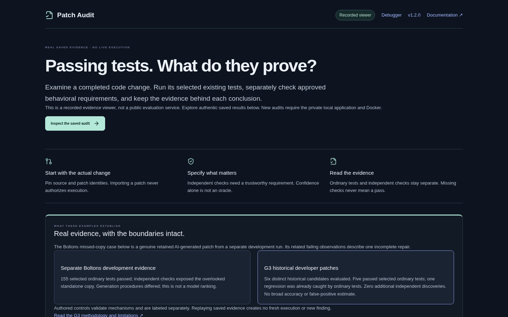
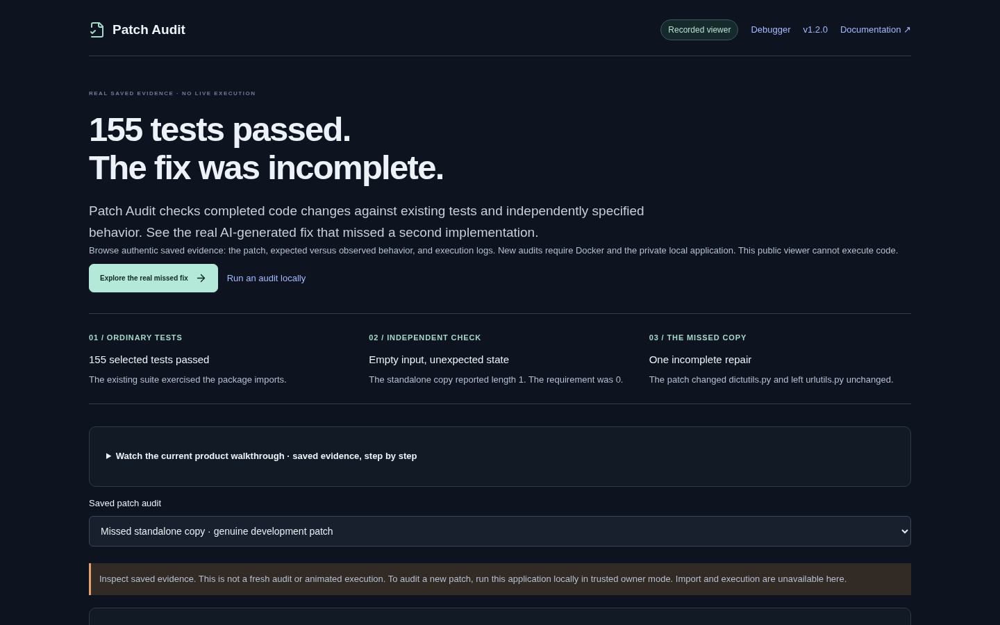

# Patch Audit public presentation review

**PR:** [#18](https://github.com/kabbersokhi-boop/ai-debugging-workbench/pull/18) · **Branch:** `docs/patch-audit-public-presentation`
**Base:** accepted `v1.2.0`, `a00bbc3399d7dde96a930c7da8db2e82f99295d6`
**Scope:** README, case study, architecture navigation, recorded-viewer onboarding, current media and a browser regression. No evaluator, admission/approval contract, schema, broker policy, campaign, inference-provider, release or deployment changes.

## 1. Previous communication failures

The accepted README already contained a sound definition, the genuine Boltons result, limitations and engineering evidence. The weakness was ordering: a first-time visitor encountered protocol detail and multiple workflows before a clear try-it path. The initial presentation pass improved that order but still had substantive faults: the case study named the wrong API (`Remap` rather than `OrderedMultiDict.addlist`), and its diagram placed execution before approval. Both are corrected.

The earlier 73-second cut scrolled through the result without opening enough of the evidence. Its captions required a separate file, and it was not playable in the website. The generic website headline also required readers to work out the concrete problem themselves. The featured-case action could point at the passing record after selection changed. The final sweep addresses these issues rather than treating cosmetic polish as sufficient.

## 2. Research references

| Reference | Relevant principle applied |
| --- | --- |
| [Ruff README](https://github.com/astral-sh/ruff) | Define the tool in one sentence and give a direct path to getting started. |
| [pytest README](https://github.com/pytest-dev/pytest) | Show a small input and actual result before the feature catalog. |
| [Promptfoo README](https://github.com/promptfoo/promptfoo) | Connect configuration, running a check and inspecting the result; make the result viewer tangible. |
| [Inspect AI log viewer](https://inspect.aisi.org.uk/log-viewer.html) | Let a reviewer drill from a result into scoring, metadata and retained logs. |
| [Memray README](https://github.com/bloomberg/memray) | Show recognizable product output and explain the engineering problem it helps diagnose. |
| [OpenSSF Scorecard](https://openssf.org/projects/scorecard/) | Explain the purpose in ordinary language and make usage paths discoverable. |

These references informed the information hierarchy and demonstration format. No text, branding, endorsement or media was copied. There is no fabricated recruiter study, audience statistic or claim of a portfolio percentile.

## 3. Narrative, audience and bounded plan

The audience is a recruiter or hiring manager first, followed by an engineer who wants to inspect the implementation. The story is **a real incomplete repair → passing selected tests → a separately justified requirement → an observed gap → inspectable execution evidence**. The public viewing route and the privileged local workflow are distinct throughout.

The highest-impact changes are a concrete first-screen result, a direct link to its evidence, an actual evidence-opening demo and a short local setup path. Deep technical detail lives in linked architecture, policy, code-tour and methodology documents. The original repository name is explained rather than renamed. The acceptance criterion is whether the first screen and first minute answer what the tool does, why it matters, what the real example showed, how to try it and what public playback cannot do.

## 4. README and technical navigation

The [README](../../README.md) leads with a product definition, the 155-test hook, public/local entry points and a current demonstration. It explains the result in a compact table before installation. Its workflow diagram places exact approval before execution. The engineering table explains concrete problems, implementation decisions and tradeoffs, with source links; it is not an unstructured framework list.

The evaluation table preserves separate denominators for the Boltons development run, G3, the producer comparison and authored controls. Detailed scope is linked rather than repeated. The [architecture document](../ARCHITECTURE.md) now opens with the current Patch Audit boundary; the earlier debugger history remains below it. The code tour already starts with Patch Audit and remains linked.

## 5. Recorded website

The first screen says **“155 tests passed. The fix was incomplete.”** and defines the product below it. Three short steps explain the selected-test pass, the standalone empty-input observation and the one incomplete repair. The main action selects the actual missed-fix record even after a visitor browses the passing record, and scrolls to it once the saved evidence loads. A keyboard regression covers that behavior.

A separate local quickstart link and an expandable native video player support the two next steps. The player has no autoplay, uses captions and an accessible transcript, and loads its 3.98 MB media only on demand. The renderer enforces a 4 MB budget below the host's documented 4.5 MB Function-response limit. Media and the poster use same-origin static assets; social preview metadata points to that poster. Full study provenance remains discoverable below the evidence rather than preceding the first useful result. Technical evidence controls, downloads, selector and earlier debugger remain available.

## 6. Current demo deliverables

The [109-second film](../../frontend/public/demo/patch-audit/walkthrough.mp4?raw=true) records actual browser interactions with the built recorded-release application. It opens the retained ordinary log, task requirement, exact patch, omitted `addlist` implementation, `standalone_urlutils:empty` expected/observed values and execution identities. It downloads the actual evidence and patch, checks their bytes, explains the separate G3 outcome and opens the real GitHub local quickstart.

The film is 1440×900, H.264/AAC, with local synthetic narration and visible captions in a dedicated band below the UI. [WebVTT captions](../../frontend/public/demo/patch-audit/captions.vtt), a [transcript](../../frontend/public/demo/patch-audit/transcript.txt), [poster](../../frontend/public/demo/patch-audit/poster.png), [capture manifest](../demo/patch-audit/current-capture.json), [script and reproduction guide](../demo/patch-audit/CURRENT-DEMO.md) accompany it. The poster crops actual result pixels and adds an editorial title. No application output, control or result text was fabricated.

Raw captures and intermediates are retained locally in `artifacts/public-presentation/`. Earlier media takes were retained separately while source-panel positioning and capture validation were corrected. The final capture has no page errors or mutation requests to the recorded origin. The final documentation page is GitHub itself; its ordinary analytics are outside that origin assertion. No new audit or coding-model inference was performed. Earlier v1.1.0 Patch Audit films and the original NVIDIA debugger walkthrough are explicitly historical.

## 7. Authentic case study and ownership

The [case study](../PATCH-AUDIT-CASE-STUDY.md) explains the one-shot iterable problem, why package imports can mask the standalone fallback, the 155 selected upstream tests and the actual empty-input observation. It links the pinned `addlist` documentation, authored task requirement, checker, exact patch and original evidence. It distinguishes an independently specified consistency property from a specification automatically discovered by a model.

The earlier Boltons record predates the generalized approval forms; the presentation does not retroactively assign those forms to its historical execution. The result is **one incomplete repair**, not several bugs. G3 is separate: six genuine historical developer patches, five ordinary passes, one regression already caught ordinarily, **zero additional independent findings**. No broad detection-rate or model-ranking claim is made.

The case study identifies Codex assistance in this presentation work. Personal motivation, individual implementation ownership, unaided expertise and learning claims are omitted pending owner confirmation.

## 8. Local execution and public viewing

The local application accepts bounded immutable public GitHub snapshots, exact production-only patches and explicitly approved Python/Node plans. Its broker has privileged Docker authority and remains private. Candidate restrictions share the host kernel and are not a complete hostile-code sandbox.

The public recorded service contains curated evidence, static media and the built frontend. It has no evaluator, database/provider credentials, Docker module/socket, mounts or candidate-execution routes. A built image was inspected, not merely its buttons. This task made no production deployment, merge or release.

## 9. Actual validation

| Check | Observed result |
| --- | --- |
| `./scripts/check` | Passed: Python lint/format/types, **387 offline tests**, TypeScript and production frontend build. The existing large lazy diff-editor chunk warning remains. |
| `E2E_BASE_URL=http://127.0.0.1:18020 ./scripts/e2e -k recorded_explorer_first` | **3 passed**: genuine failed/passed Patch Audit records, diff/download, earlier debugger, desktop/mobile and no mutation requests. Includes the new keyboard featured-record regression. |
| Restricted image / `scripts/check_release.py` | Passed: non-root/read-only, zero mounts, bounded resources, no authority modules/socket/credentials, zero execution slots/provider budget, private GET 404 and mutation POST 405. [Receipt](assets/patch-audit-presentation-boundary.json). |
| Served media and browser playback | Exact media/poster/caption/transcript hashes; MP4 Range request 206; keyboard-started native playback decoded frames and sought to the independent observation. Eighteen caption cues loaded; no page/console errors or mutation requests. [Receipt](assets/patch-audit-presentation-validation.json). |
| Responsive checks | No document overflow at **360, 390, 768 and 1440px**. Actual screenshots inspected; a mobile label layout issue found during visual review was corrected. |
| Media decode | Full FFmpeg decode passed; 108.74 seconds; about 3.98 MB; audio peak −1.1 dB. Caption samples were inspected against the actual method and observation frames. |
| Historical preservation | **1,726 existing files** across evaluation inputs, recordings, frozen evals, reports, runtime source and migrations match accepted-base Git blob identities. `v1.2.0` still resolves to the accepted commit. [Receipt](assets/patch-audit-presentation-preservation.json). |
| Links and formatting | Changed-document relative paths, media references and `git diff --check` checked before handoff. |
| Full established CI | Exact final-head workflow status and run URL are recorded on [PR #18](https://github.com/kabbersokhi-boop/ai-debugging-workbench/pull/18/checks); this is separate from the local checks above. |

No independent human testers were available. Browser automation and this author's first-minute walkthrough are not evidence of unaided human comprehension.

## 10. Before and after

The before image is the actual existing production deployment. The after images are the local review build at the same desktop viewport and at 390px mobile width. The production service has not been changed.

| Before | After |
| --- | --- |
|  |  |

[Mobile intro](assets/patch-audit-presentation-after-mobile.png) · [Mobile result](assets/patch-audit-presentation-result-mobile.png) · [Actual in-page video playback](assets/patch-audit-presentation-video-playback.png).

## 11. Remaining limitations

The film shows saved inspection and the local setup instructions, not a newly executed generalized audit. Its voice is synthesized; no human narration or independent human comprehension feedback is claimed. GitHub's repository file viewer does not play this MP4, and GitHub strips embedded video HTML. The README therefore labels the raw-file link as a download and bypasses the unhelpful binary preview; the recorded preview website has a verified native player. The final MP4 download path was checked against its exact hash. The production URL remains on the accepted version until separately authorized publication.

Trustworthy requirement authoring and Docker setup remain substantial work for a new local user. The historical convenience samples establish no general accuracy rate, and G3 provides no added detections. The repository does not grant a project license. No personal ownership claims were inferred from commit metadata.

## 12. Candid recruiter assessment

**First-impression clarity: 6/10 before; 8.5/10 after.** This is an explicit author assessment, not a measured percentile or human-study result. The earlier material was technically credible but demanded more reading. The current first screen names the problem and real result, the film opens the evidence, and the local/public choices are concrete. The engineering is now easier to assess because design decisions link directly to the implementation.

A first-minute walkthrough can answer the six acceptance questions: Patch Audit inspects finished changes; tests can miss required behavior; it compares declared check sets and retains evidence; the real AI patch missed a standalone copy; saved evidence needs no install and new audits use local Docker; the public site cannot run code. A skeptical reviewer can also find the negative G3 outcome and sandbox limitations without reconstructing milestone history.

**Engineering quality is not rescored.** Presentation changes do not strengthen the underlying study or establish production effectiveness. Stronger external evidence would require genuine user feedback or independently successful use, not more visual polish.

**Recommendation: content is ready for independent review. BLOCK publication until the owner-requested independent review of the actual changes and media is complete.**
